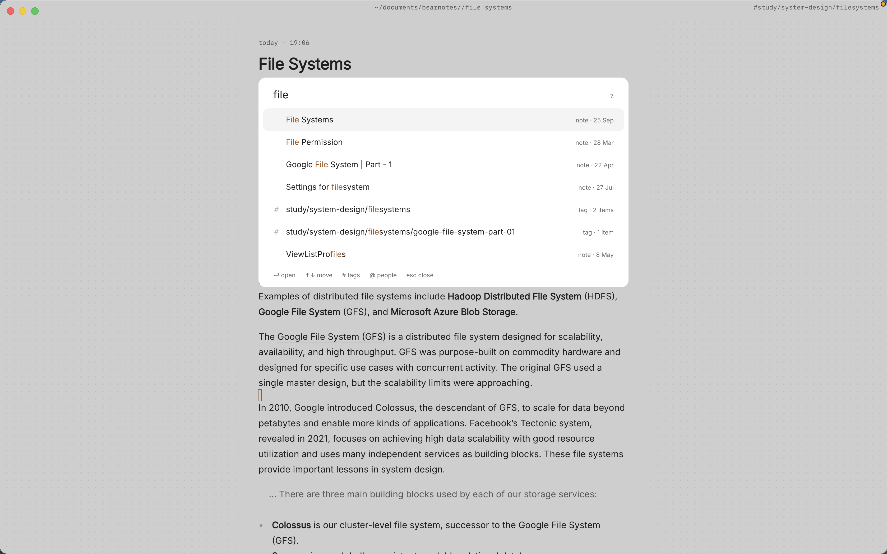

You read a lot, forty or fifty books a year, and you underline as you go. But the underlines stay in the books. A year later you remember that someone wrote something sharp about attention and cities, maybe in a book about walking, maybe in a novel, and you can't find it. The highlights you saved are scattered across a reading app, a few photos of pages and the margins of a paperback you lent to a friend.

What you want is one place for book notes: a page per book with the quotes that mattered and what you thought of them, a way to see which ideas keep coming back across books, and a search that finds a sentence when you only remember three words of it. Paperkites keeps every note as a plain markdown file on your Mac, so your book notes in markdown are yours to keep, readable in any editor, long after you've forgotten which app you read on.

This article shows how to set up a reading vault, what to write while and after reading, and how to find a half-remembered quote again.

## Setting up your reading notes

Make a folder such as `~/Reading` and open it as your vault, or add a `books` folder to a vault you already use. Keep it simple:

- `books/` with one note per book, titled with the book's title.
- `ideas/` for notes about ideas that cut across several books.
- A single note called "Reading list" at the top.

⌘\ shows the sidebar, with folders that mirror the vault on disk.

Front matter is a good place for the facts about a book: author, year, when you started and finished, a rating if you give them. Paperkites leaves your front matter alone apart from three fields it manages itself (`id`, `created` and `pinned`).

Then pick tags for themes, not for genres you could look up. Nested tags keep them in order: `#theme/attention`, `#theme/work`, `#theme/grief`, plus `#fiction` or `#nonfiction` if you want the split. Themes are what you'll search by later.

## Reading a book, note by note

### While you read

When a line stops you, on the train or in bed, you don't want to open the right note and find your place in it. The app opens on a capture box: type the quote, the page number and a word or two of reaction, and press ⌘↩. It's kept as a fragment, a short note with no title, and you're back to the book.

⏎ adds a new line and never saves, so a long quote can run over several lines. `esc` never throws a draft away, even if you close the app. If a thought turns into a paragraph, ⌘E opens it as a full note instead.

For paper books, a photo of the page works too. Drag or paste it onto the book's note and it's copied into the vault's `attachments/` folder. Set it to size S so it doesn't take over the page, and add a caption with the page number.

### After a reading session

Every few days, gather the fragments into the book's note. The list shows everything newest first with the date once per day in the gutter, so `[d` and `]d` jump back through the days you were reading, and `j` / `k` step through each fragment. Copy each quote into the book note under a heading for its chapter or theme, then add a line of your own underneath.

That line is the part most people skip, and it's the part that makes the notes worth rereading. A quote alone tells you what the author said. A quote with "this is the opposite of the last book I read about streets" tells you what you thought.

Highlights you've already made elsewhere can be pasted in as text. Mark the phrase that matters most inside a longer quote with `==highlight==`, and put longer reflections in a callout so they stand apart from the author's words.

### Linking ideas across books

When the same idea turns up in a second book, write an idea note: "Attention is a kind of care", say, in `ideas/`. Link to the passage in each book with a heading link, `[[The Art of Noticing#Walking]]`, so the link lands on the section rather than the top of a long note. `[[Title|alias]]` lets the link read naturally in a sentence.

`gd` follows the link under the cursor, `K` peeks at it without leaving the note, and ⌃o goes back. With ⌃w v you can split the view and keep the idea note open beside the book you're quoting from. If idea notes become the heart of your reading, [a Zettelkasten in markdown](/usecase/zettelkasten-markdown-mac) takes the habit further.

### The reading list

The "Reading list" note is a list of todos: one `- [ ]` line per book you want to read, with who recommended it. When you start one, make its note in `books/`; when you finish, ⌘↩ ticks the line off. `:todos` gathers every open todo in the vault, under Overdue, Today, Upcoming and No date, so the list is never more than one command away. [How todos work](/docs/todos) covers the rest.

## An example book note

```markdown
---
author: Henry David Thoreau
year: 1854
finished: 2026-10-12
---

# Walden

#nonfiction #theme/attention #theme/simplicity

## Where I Lived, and What I Lived For

> "I went to the woods because I wished to live deliberately,
> to front only the essential facts of life."

The point isn't the woods, it's the deliberately. Same claim,
different angle, in [[ideas/Attention is a kind of care]].

## On simplicity

> "Our life is frittered away by detail."

My summary: most of what fills a day was never chosen.
==He counts the cost of things in hours of life, not money.==
Compare how [[Meditations#On what is up to us]] gets there
two thousand years earlier.

## Follow-ups
- [ ] Read his essay "Walking" next
- [ ] Reread the chapter on solitude
```

Front matter for the facts, theme tags, quotes under the chapter they come from, your reaction under each, two links that tie this book to an idea and to another book, and a couple of todos that `:todos` will remind you of.

## Finding a half-remembered quote

This is where keeping book notes as text pays off.

- **`/`** searches the text of every note in under 100 ms on 10,000 notes. Type the words you remember, "live deliberately", and the quote comes back with its book. If too much matches, add a tag: `#theme/attention` narrows the search to that theme.
- **⌘K** finds a book note, fragment, tag or command by any word in its title, in one ranked list.
- **`:tags`** shows the tag tree. A theme's page shows its child tags and the tags most often used with it, which is a neat way to notice that your attention books keep sitting next to your grief books.
- **Backlinks** at the foot of a note show each note that links to it, with the sentence the link sits in. Open an idea note and see every book that fed it, and what you said about each.
- **⌃r** renames a tag in every file at once, for the day `#theme/work` becomes `#theme/labour`.

The [finding docs](/docs/finding) list every search option.



## Where Pro helps

The core app, including everything above, is free for good. A few Pro features suit a heavy reader:

- **People:** `@mentions` point at person notes, with aliases. Make a note for an author you return to, mention them as `@Thoreau`, and their page gathers every sentence that mentions them across all your book notes, plus who and what often comes up alongside them. The [people docs](/docs/people) show how aliases work.
- **Task markers:** five todo states beyond open and done (cancelled, moved, scheduled, in progress, priority), picked with ⌘⇧↩. "In progress" for the book on your nightstand and "cancelled" for the one you gave up on are more honest than a plain checkbox.
- **The graph:** `:graph` or `gr` shows tags as nodes with notes hanging off them, a picture of which themes your reading clusters around.

Pro is one payment with a 14-day trial, no card needed. If the trial ends without buying, Pro features go read-only and every note still opens.

## In short

Catch the line when it stops you, gather it into the book's note with a sentence of your own, and link it to the idea it belongs to. Do that for a year of reading and you'll have more than a pile of highlights: you'll have a record of what you thought, searchable by the three words you remember.
