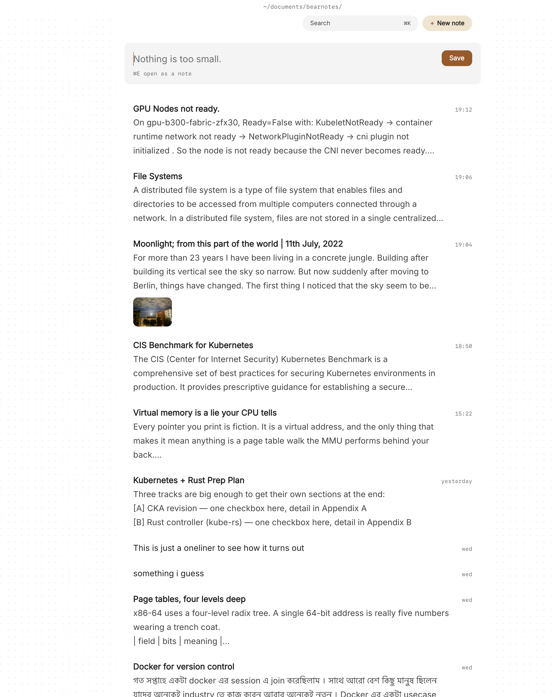

Designers collect constantly. A checkout flow that handled errors well, a settings page with a clever empty state, three competitors' onboarding screens captured before a kickoff. The screenshots pile up in a Desktop folder called `refs`, the thinking about them lives in a separate doc, and by the time you need the example ("there was a date picker that did this right"), you can't find the picture or remember why you saved it.

What helps is design research notes where the image and the reason sit together: a few screenshots side by side, a line on what's good about them, a tag for the pattern, and a link to the project it's for. As files you own, in a folder you can open from anything.

This article shows how to keep image-heavy design research notes on your Mac in Paperkites: setting up the vault, collecting references, writing critique, and pulling the right example back up in a review.

## Setting up a vault for design research

Paperkites keeps every note as a plain `.md` file in a folder you choose. Images you add are copied into an `attachments/` folder inside that vault, never moved from where they came from and never written over another file. So your screenshots stay in Finder, next to the notes that explain them, and the original stays where you took it.

A layout that suits most design work:

- `projects/`, one note per project, holding the brief and the decisions
- `research/`, for competitor sweeps and pattern collections
- `critique/`, for reviews of your own work in progress
- `inspiration/`, for things that caught your eye with no project yet

⌘\ shows the sidebar, with folders that mirror the vault on disk.

Tags do the cross-cutting work: one family for projects, one for patterns.

| Tag | Use it for |
|---|---|
| `#project/checkout` | Everything feeding one project |
| `#pattern/empty-state` | A UI pattern, across all projects |
| `#pattern/onboarding` | Another pattern |
| `#platform/web` | Where you saw it |
| `#good` / `#avoid` | Your verdict |

A screenshot of a competitor's error message might carry `#project/checkout`, `#pattern/errors` and `#avoid`. That's three ways back to it later.

## Collecting and critiquing, day to day

### Dragging in screenshots

Drag a screenshot onto a note, or paste it from the clipboard. It's copied into `attachments/` and shows in the note where you dropped it. Several images in a row show side by side, which is how comparison work wants to look: four onboarding first screens across one line, at a glance.

Each image can be shown at S, M, L or Full. Small suits a strip of thumbnails in a pattern collection; Full suits the one screen a critique is about. Images take captions, so the reason you saved one ("inline validation, appears on blur, not on keypress") sits right under it. Open an image in the large view when you need to see the detail of a 1px border or a type size.

Files that aren't images, such as a PDF of a brand guide or an exported prototype, appear as cards that open in their own app. ⌥-click shows them in Finder. [Images and files](/docs/images-and-files) covers the details.

### Quick capture while browsing

The app opens on a capture box. When you spot something mid-task, type a line ("the Settings search on that banking site, look again") and press ⌘↩ to keep it as a fragment, a short note without a title. Later, ⌘E opens it as a full note, and you can drag in the screenshot and tag it properly.

### Pattern collections

A pattern note collects examples of one thing: `Empty states`, `Date pickers`, `Destructive confirmations`. Each example gets a short heading, the screenshots, a caption, and a line or two of what works. These notes become your own reference library, and because they're tagged by pattern rather than project, they carry over from job to job.

### Critique notes linked to the project

When you review your own work, write a critique note per round: `Checkout, review 2`. Drop in the current screens and write what's working and what isn't, screen by screen. Link it to the project note with `[[Project: Checkout redesign]]`, and to any pattern note it draws on with `[[Destructive confirmations]]` or `[[Empty states#Good examples]]` to point at a heading.

In the project note, the backlinks then show every critique round and research note that links to it, each with the sentence it sits in. That's the project's history of decisions, in order, without keeping a separate log.

`gd` follows a link and `K` peeks at it without leaving the note, so in a critique you can glance at the pattern reference and come straight back. Splits help when comparing directly: ⌃w v opens a second pane, ⌃w w moves between them, ⌃w q closes one. Your screens on the left, last round's critique on the right.

### Changes to make, as todos

Critique produces a list. Any line written `- [ ]` is a todo, so the changes go right under the screen they're about. ⌘↩ ticks one off. `:todos` lists every open todo across the vault, so the fixes from three critique rounds are in one place before the next review.

### Tables for comparisons

When a comparison is about facts rather than looks (which competitors offer guest checkout, how many steps each flow takes), a table says it better than a paragraph. Paperkites renders markdown tables, and Mermaid diagrams for a quick flow sketch. See [tables, diagrams and math](/docs/tables-diagrams-math).

## An example critique note

```markdown
# Checkout, review 2

#project/checkout #pattern/errors #platform/web

For [[Project: Checkout redesign]]. Compare with
[[Inline validation#Good examples]].

## Payment step


- Card field errors only show on submit; move to on blur
- "Pay now" and "Back" have equal weight; back should be quieter
- Good: the total stays visible while the keyboard is up

## Address step

| Flow | Steps | Guest checkout |
|---|---|---|
| Ours (v2) | 4 | Yes |
| Competitor A | 3 | Yes |
| Competitor B | 5 | No |

## Changes for review 3
- [ ] Inline validation on card number and expiry
- [ ] Demote the Back button to a text link
- [x] Keep total pinned above the keyboard
```

In the app, screenshots dropped onto the note sit side by side with their captions; the table and the todos render as you'd expect.

## Finding the right example in a review

Someone asks in a review, "have we seen anyone do this well?" You want the answer before the meeting moves on.

- **⌘K** finds notes, fragments, tags and commands in one ranked list. Type `date pick`, ⏎, and the pattern note is open.
- **`/`** searches the text of every note, captions and critique included. Narrow it with a tag: "validation" with `#pattern/errors` skips every note where the word is incidental.
- **The list** shows previews with a note's first lines, its todos and up to two images, so scrolling `research/` is half visual. `j` and `k` move, ⏎ opens.
- **`:tags`** shows the tag tree. A tag's page shows the tags often used with it, so `#pattern/onboarding` might show it mostly travels with `#avoid`, a hint your references lean negative.
- **⌃r** renames a tag in every file at once, when `#pattern/modals` should have been `#pattern/dialogs`.
- **`:orphans`** finds notes nothing links to: inspiration you saved and never connected to anything.



If your research is more about people than pixels, such as interviews and usability sessions, the same structure works alongside [product manager notes](/usecase/product-manager-notes-mac).

## Where Pro helps

The core app is free for good, and images, tags, links and search are all in it. Two Pro features suit design work.

- **The graph** (`:graph` or `gr`) is a live canvas where tags are nodes and notes hang off the tags they carry. With project and pattern tags, it shows which patterns your research keeps returning to and which projects share them. See [how the graph works](/docs/graph).
- **More themes and your own CSS themes.** If you care how your tools look, and designers usually do, you can write a theme of your own.

Pro is one payment with a 14-day trial, no card needed. If the trial ends without buying, Pro features go read-only and every note still opens.

## In short

Never save a screenshot without the reason. Put it in a note, caption it, tag it by project and pattern, and link each critique to the project it serves. Over a few projects, that becomes a reference library you built yourself, and the example you need in a review is one search away.
