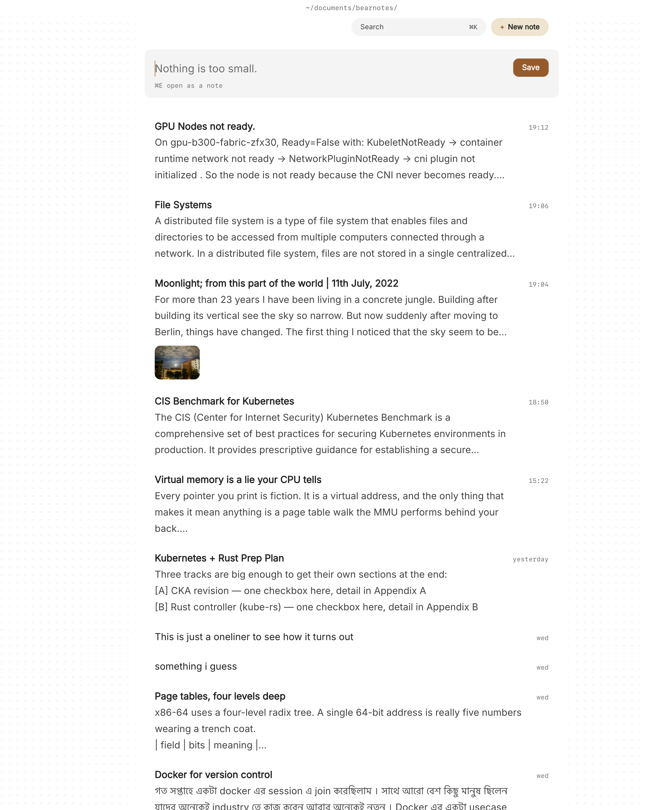

If you want developer notes as plain markdown in git on your Mac, start with where they live now. They're spread out. The deploy steps are in a README nobody updates, the debugging trail from last month is in a chat thread, and the design decision you'll need to defend next quarter is in a scratch file called `notes2.txt`. You want them in one place, but you don't want a notes app that keeps them in a database you can't diff, grep or put under version control.

Paperkites keeps every note as a plain markdown file in a folder you choose. It has no git features of its own, and it doesn't need them: that folder can be a git repository you manage yourself, so your developer notes get the same history, branches and backups as your code, and you can still open them in your editor of choice.

This article shows how to set up markdown notes in a git repo on your Mac, how to work in them day to day with the keyboard, and how to find things again months later.

## Setting up a vault in a git repo

A Paperkites vault is just a folder of `.md` files. There's no account and no database, so setting one up for git takes a minute:

1. Make a folder, for example `~/notes`, and run `git init` in it.
2. Open it as your vault in Paperkites.
3. Make a few top-level folders that match how you work, such as `runbooks`, `debugging`, `decisions` and `daily`. The sidebar (⌘\) mirrors these folders as they are on disk.
4. Settle on a handful of nested tags, such as `#work/payments`, `#work/infra` and `#til` for things you learn.

From here, git is yours to run: commit, branch and push from the terminal or whatever git tool you already use. Paperkites leaves your front matter alone apart from three fields it manages, `id`, `created` and `pinned`. If those appear in a diff, that's why; nothing else you wrote changes.

If you already keep notes in an Obsidian vault, point Paperkites at it instead. It opens the vault as it is, wiki links, embeds and callouts included. Read more about [how Paperkites treats your files](/docs/your-files).

## A week of notes: capturing, writing and linking

### Capturing while you work

The app opens on a capture box. When something comes up mid-task, such as a flaky test name or a command that finally worked, type it and press ⌘↩. It's kept as a fragment, a short note without a title, and you're back to work. ⏎ only adds a new line and never saves, and `esc` never throws a draft away, even if you quit.

If the thought turns out to be bigger than a line, press ⌘E to open it as a full note instead.

### Moving with the keyboard

The list moves the way your editor does, with or without vim keys turned on in `:settings`:

| Keys | What they do |
|---|---|
| `j` / `k` | Move down and up the list |
| `gg` / `G` | Jump to the top or bottom |
| `[d` / `]d` | Jump back or forward by a day |
| ⏎ | Open the note |
| `x` | Pin the note |

The list is newest first, with the date shown once per day, so yesterday's debugging session is a `]d` away. A vault with ten thousand items still scrolls without dropping frames.

### Writing runbooks and decision records

The editor is live preview: the block you're in shows its markdown, and everything else is rendered. That suits the kind of notes developers write, which mix prose with commands, tables and the odd diagram.

A few things are worth knowing on day one:

- `[[Title]]` links to another note, `[[Title#Heading]]` links to a heading inside it, and `[[Title|alias]]` changes the link text.
- `gd` follows the link under the cursor, `K` peeks at it without leaving the note, and ⌃o and ⌃i go back and forward, much like jumping through code.
- Retitling a note rewrites every link to it across the vault. If that wasn't what you wanted, `:undo` reverts it.
- `:format` tidies the markdown in the current note.
- `:daily` opens today's note, a good home for a running log of what you tried and what happened.

### Diagrams and tables

Request flows and state machines are easier to read as pictures. Paperkites renders Mermaid diagrams written in the note, as well as tables and LaTeX math, so a decision record can carry its own sequence diagram in plain text that diffs cleanly. See [tables, diagrams and math](/docs/tables-diagrams-math) for the syntax it understands.

Screenshots of a dashboard or an error dialog can be dragged or pasted straight onto a note. They're copied into `attachments/` inside the vault, never moved and never written over another file, so they're committed alongside the note that refers to them.

### Keeping track of loose ends

Any line written as `- [ ]` is a todo, wherever it sits. ⌘↩ ticks it off. When you want to see what's still open across the whole vault, `:todos` lists every todo under Overdue, Today, Upcoming and No date, so the "follow up with the payments team" buried in Tuesday's incident note doesn't get lost.

## An example note: a debugging log

Here's what a note in `debugging/` might look like after an afternoon chasing a timeout:

```markdown
Checkout timeouts after the pool change

#work/payments #debugging

Started after the connection pool was cut from 50 to 20
in [[Decision: smaller DB pools]].

## What we saw
- p99 on `/checkout` went from 300 ms to 4 s at peak
- Only the payment worker; the API was fine
- Pool wait time maxes out at exactly 5 s

## What we tried
- Raised `POOL_SIZE` back to 50 on one instance: fixed there
- Checked slow queries: nothing new

## Next
- [ ] Add a pool wait metric to the payments dashboard
- [ ] Write up the limit per worker in [[Runbook: payments deploy]]
- [x] Roll back the pool change in staging
```

The two wiki links tie the investigation to the decision that caused it and to the runbook that needs updating, and the tags put it in the right place in the tag tree.

## Finding it again: search, tags and backlinks

Months later, the trick is getting back to the right note without remembering where you put it.

- **⌘K** finds notes, fragments, tags and commands in one ranked list, in under 50 ms on 10,000 items. Type a few letters of a title and press ⏎.
- **`/`** searches the full text of every note, in under 100 ms on 10,000 notes. Add `#work/payments` to narrow it to a tag, so "timeout" doesn't return every note that ever mentioned one.
- **`:tags`** shows the tag tree. A tag's page lists its child tags and the tags most often used with it, which is a quick way to see what else tends to break alongside payments.
- **Backlinks** at the foot of a note show the sentence each link sits in. Open "Decision: smaller DB pools" and you'll see the debugging log above, with the line that mentions it.
- **⌃r** renames a tag in every file at once, for when `#infra` becomes `#work/infra`.
- **`#empty_kite`** finds untagged notes, and **`:orphans`** finds notes nothing links to. Both are worth a look every few weeks to keep the vault tidy.

The [finding docs](/docs/finding) cover every search option, and [keys and commands](/docs/keys-and-commands) lists the rest.



## Living alongside git and your editor

Because the vault is ordinary files, nothing stops you from editing a note in your usual editor, running a script over the folder, or pulling a teammate's changes. Paperkites doesn't commit, push or pull for you, but it notices what git does: edits made elsewhere show up while it's running, so after a `git pull` in the terminal, the notes you have open are already up to date.

There's no analytics and no telemetry, and the notes never leave the folder unless you push them somewhere.

Splits help when you're writing one note against another: ⌃w v opens a second pane, ⌃w w moves between them, and ⌃w q closes one. A runbook next to the incident log you're turning into it is the usual case.

## Where Pro helps

The core app is free for good. Two Pro features fit this kind of work well:

- **Task markers** add five states beyond open and done: cancelled, moved, scheduled, in progress and priority (⌘⇧↩ picks one). In a debugging log, "in progress" and "cancelled" say more than a plain checkbox.
- **The graph** (`:graph` or `gr`) is a live canvas where tags are nodes and notes hang off the tags they carry, which shows which areas of the system your notes cluster around.

Pro is one payment with a 14-day trial, no card needed. If the trial ends without buying, Pro features go read-only and every note still opens.

## In short

Treat your notes like code: plain files, in a repo, with history. Capture the small things as they happen, link each investigation to the decision and the runbook it touches, and let search and backlinks do the remembering. A year from now, the answer to "why did we do it this way" will be one ⌘K away.
