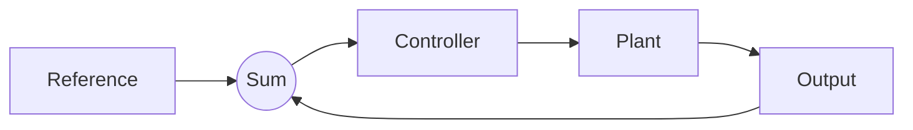
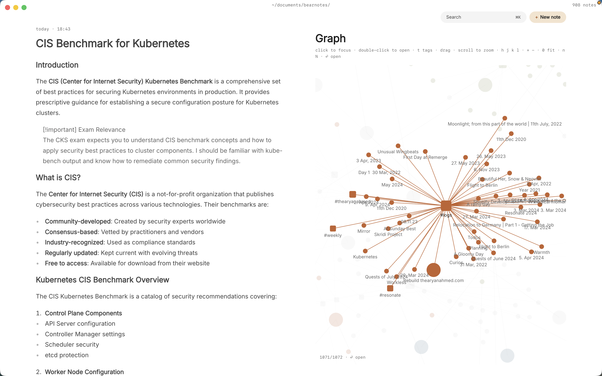

Engineering notes are half equations and half pictures. A control systems lecture is a transfer function, a block diagram and a Bode plot in twenty minutes. A word processor makes the math painful, paper makes it unsearchable, and a full LaTeX document for every lecture is too slow to keep up with.

What helps is a notes app that writes math as LaTeX, draws diagrams from text, and lets the Laplace transform you learned in signals link to the controls lecture that uses it. Paperkites is a markdown notes app for the Mac that renders LaTeX math and Mermaid diagrams inline, and keeps every note as a plain `.md` file in a folder you own.

This article shows how to set up engineering student notes with LaTeX on a Mac, how to work through a week of lectures and problem sets, and how to find a formula again when the final is a week away.

## Setting up a vault for your modules

A vault is a folder of markdown files. No account, no database. Make one for your degree and give each module its own folder:

- `signals/` for Signals and Systems
- `controls/` for Control Systems
- `circuits/` for Circuit Analysis
- `concepts/` for ideas that cross modules: Laplace transform, convolution, eigenvalues, phasors
- `psets/` for problem set notes, one per assignment

⌘\ shows the sidebar, with folders that mirror the vault on disk.

The `concepts/` folder is the important one. Lecture notes are tied to a module and a date; concept notes are not. When "stability" comes up in controls and again in circuits, both lectures link to one `[[Stability]]` note rather than each defining it from scratch.

Add a few nested tags for the second axis: `#ee/signals`, `#ee/controls`, `#ee/circuits`, plus `#formula` for notes that are mostly reference and `#pset` for assignments.

## A week of lectures and problem sets

### Writing the math as you go

In the live-preview editor, only the block you're in shows its markdown. Type a LaTeX expression and it renders once you move on, so a page of derivation reads like a textbook, not like source code. The exact syntax Paperkites accepts is in [tables, diagrams and math](/docs/tables-diagrams-math).

If you're quicker on the keyboard than the trackpad, turn on vim keys in `:settings`. `:format` tidies the markdown in a note when a fast lecture has left it ragged.

### Block diagrams and state machines in Mermaid

A feedback loop or a finite state machine is clearer drawn than described. Mermaid lets you write the diagram as text inside a code block, and Paperkites renders it in the note. A unity-feedback loop is four lines; a traffic-light controller's states and transitions are a few more. Because the diagram is text, editing the transitions in a digital logic lab is a matter of changing a line, not redrawing boxes.

For diagrams Mermaid can't draw, such as a circuit schematic from the slides, drag or paste a screenshot onto the note. It's copied into `attachments/` in the vault, never moved and never written over another file.

### Tables of formulas

Some notes are mostly reference: Laplace transform pairs, op-amp configurations, standard second-order responses. Markdown tables render in place, so a transform table stays as tidy as the one in the back of the textbook. Tag these `#formula` so they're easy to pull up together.

### Linking concepts across modules

Wiki links do the cross-module work:

- `[[Laplace transform]]` links to the concept note.
- `[[Laplace transform#Final value theorem]]` jumps to a heading inside it.
- `[[Root locus|root locus sketch]]` keeps the sentence natural.

`gd` follows a link, `K` peeks at it without leaving the page, and ⌃o / ⌃i go back and forward. In a split (⌃w v), you can keep the concept note open while working a problem in another pane; ⌃w w moves between them and ⌃w q closes one.

Retitling a note rewrites every link to it. Rename "LT" to "Laplace transform" and every lecture follows; `:undo` reverts it.

### Problem-set todos

Any line written as `- [ ]` is a todo. Put them in the problem set note, next to the questions they belong to, and tick them with ⌘↩. `:todos` lists every todo in the vault under Overdue, Today, Upcoming and No date, so three modules' worth of assignments show up in one place. How dates on todos are written and sorted is in [how todos work](/docs/todos).

## An example note: a controls lecture

Here's a lecture note in `controls/`, after a session on second-order systems.

````markdown
# Controls L7: second-order step response

#ee/controls #formula

Builds on [[Laplace transform]] and [[Transfer functions]].

## Standard form

$$
G(s) = \frac{\omega_n^2}{s^2 + 2\zeta\omega_n s + \omega_n^2}
$$

Damping ratio $\zeta$ decides the shape: under, critically
or over damped. See [[Stability#Pole locations]].

## Quick reference

| Quantity | Approximation |
|---|---|
| Percent overshoot | exp(-zeta pi / sqrt(1 - zeta^2)) |
| Settling time (2%) | 4 / (zeta omega_n) |

## Loop



## Problem set 4
- [ ] Q2: find zeta for 10% overshoot
- [ ] Q3: sketch the root locus, compare with [[Root locus]]
- [x] Q1: identify the order of each system
````

The links tie the lecture to concept notes that signals and circuits lectures point at too, and the `#formula` tag puts the reference table alongside the others.

## Finding a formula again

The week before an exam, you need a specific equation, not a module.

- **⌘K** finds notes, fragments, tags and commands in one ranked list, in under 50 ms on 10,000 items. A few letters of "second-order" is enough.
- **`/`** searches the text of every note. Narrow it with a tag: "overshoot `#ee/controls`" skips the circuits notes that happen to use the word.
- **Backlinks** on a concept note show the sentence each link sits in. Open `[[Laplace transform]]` and you see every lecture, from every module, that relies on it. That list is a revision path through the term.
- **`:tags`** shows the tag tree, and a tag's page lists its child tags and the tags often used with it. `#formula` alongside `#ee/signals` is your formula sheet for that exam.
- **`:orphans`** finds notes nothing links to. A concept note with no backlinks usually means a lecture you didn't connect.

The [finding docs](/docs/finding) list every option.

If you also keep lab notes or a lab notebook, the same habits work there; see [a research notebook in markdown](/usecase/research-notebook-markdown-mac).

## Where Pro helps

The core app is free for good, and LaTeX, Mermaid, tables, links and todos are all in it. Two Pro features suit a degree with many modules:

- **The graph** (`:graph` or `gr`) is a live canvas where tags are nodes and notes hang off the tags they carry. Concept notes tagged across `#ee/signals` and `#ee/controls` sit between both clusters, which shows where the modules overlap.
- **Areas and projects** give you Inbox, Today, Upcoming, Anytime, Someday and Logbook. A module can be an area and each problem set a project, so the week's work is in one view.

Pro is one payment with a 14-day trial, no card needed. If the trial ends without buying, Pro features go read-only and every note still opens.



## In short

Write equations as LaTeX and diagrams as text, so both stay editable and searchable. Keep each concept in one note and link every lecture that uses it, put problem-set tasks next to the questions, and let backlinks show you how the modules connect. By finals, your notes read like a textbook you wrote yourself.
