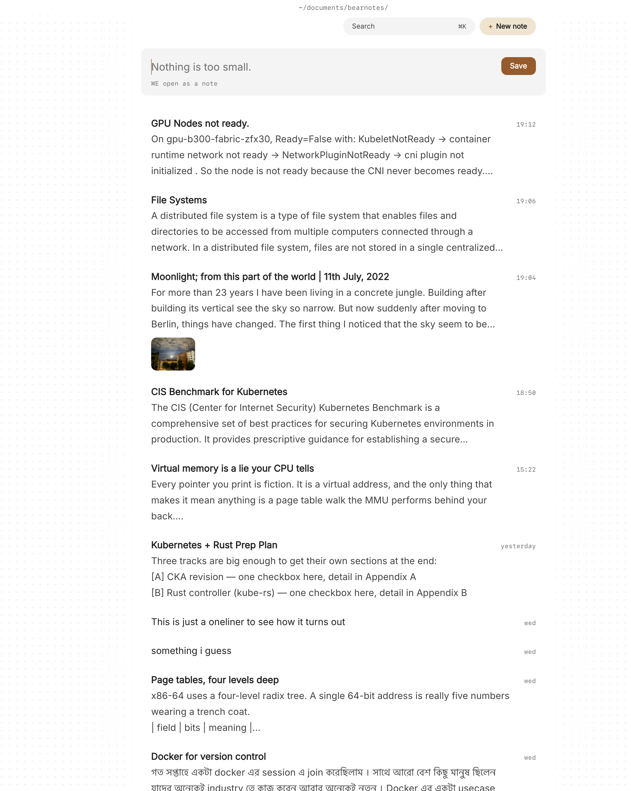

When you freelance, every client brings their own world. One has a Slack you check twice a day, another emails you a brief as a Word file, a third prefers a quick call and never writes anything down. Somewhere in all of that are the decisions you'll be held to: the scope you agreed on the second call, the revision you said was included, the login you were sent in a message that has since scrolled away.

Good freelancer client notes fix most of this. One place per client, a note for every call, and a list of what you owe each of them this week. Paperkites keeps all of it as plain markdown files in a folder on your Mac, so your records are yours, readable in any editor, and not tied to any client's tools.

This article walks through a setup for consultants and freelancers: folders and nested tags per client, call notes, todos per deliverable, and the Pro features that help when you're juggling several engagements at once.

## Setting up a folder and tag per client

A vault is a folder of `.md` files that you choose. Make one, say `~/clients`, open it in Paperkites, and give each client a folder inside a `clients/` folder: `clients/acme`, `clients/northwind`, `clients/bluebird-studio`. Add an `admin/` folder for your own business: invoicing notes, templates, the tax checklist.

⌘\ shows the sidebar, with folders that mirror the vault on disk.

Then add one nested tag per client: `#clients/acme`, `#clients/northwind`. It feels like repeating yourself, but folders and tags do different jobs. The folder decides where a note lives. The tag lets a note that lives elsewhere, such as today's daily note or an `admin/` note about invoicing, still count as Acme's. Under each client tag you can add the type of work when it helps: `#clients/acme/website`, `#clients/acme/retainer`.

Start each client with two notes:

- **A client overview.** Who's who, how they like to be contacted, the rate and terms you agreed, links to the brief and contract (drag the PDF in and it becomes a card that opens in its app).
- **A running scope note.** What's in, what's out, and every change, dated. This is the note you'll be glad of when "just one more page" comes up.

## A week of client work: calls, deliverables and follow-ups

### Taking call notes

Before a call, open the client's overview with ⌘K so names and context are in front of you. During the call, write a new note in the client's folder titled with the client and date, such as `Acme call 2026-11-03`. The editor shows rendered markdown everywhere except the block you're typing in, so you can write fast in plain markdown and the note still reads cleanly afterwards.

If something comes up between calls, such as a text from the client or an idea in the shower, the capture box takes it. Type it and press ⌘↩ to keep it as a fragment, or ⌘E to open it as a full note. ⏎ is a newline and never saves, and `esc` never throws a draft away.

Link each call note back to the client's notes with `[[Acme overview]]` or `[[Acme scope]]`. That's what makes the history trail work later.

### Todos per deliverable

Write deliverables as todos in the notes where they come from:

```markdown
- [ ] Homepage wireframes, two options
- [ ] Revised copy for pricing page
- [ ] Send invoice for October retainer
```

⌘↩ ticks one off. `:todos` lists every todo in the vault under Overdue, Today, Upcoming and No date, across every client, which is the view you want on a Monday morning. There's more in [how todos work](/docs/todos).

### Keeping a simple log of hours

Paperkites doesn't track time, but a table in the client's overview does the job if you bill by the hour and just need a record:

| Date | Hours | Work |
|---|---|---|
| 2026-11-03 | 2.5 | Wireframes, call |
| 2026-11-05 | 4 | Pricing copy |

It's plain markdown, so it stays readable in any editor, and `:format` tidies the columns when they drift.

### Following the thread

Inside a note, `gd` follows the link under the cursor and `K` peeks at it without leaving. ⌃o and ⌃i go back and forward. When you're writing a proposal and want last month's call notes beside it, ⌃w v opens a split, ⌃w w moves between panes and ⌃w q closes one.

## An example note: a client call

```markdown
# Acme call 2026-11-03

#clients/acme/website

With @sam (marketing lead) and @jo (dev). Follows [[Acme scope]].

## Agreed
- Two homepage options instead of three, same fee
- Pricing page moves into this phase
- Launch target stays end of November

## Open
- Jo needs final copy before building the pricing table
- They may want a blog template; not in scope yet

## Deliverables
- [ ] Homepage wireframes, two options
- [ ] Pricing page copy, first draft
- [ ] Update [[Acme scope]] with the pricing page change
- [x] Send call summary to Sam
```

The note links to the scope note it changes, so that note's backlinks now show this call, with the sentence around the link. The tag puts it under Acme in the tag tree, and the todos turn up in `:todos` next to every other client's.

## Finding past agreements later

Three months on, the client says "we agreed the blog was included." Here's how you check:

- **`/`** searches the text of every note. Type `blog #clients/acme` and the search narrows to Acme's notes, so you see exactly when the blog came up and what you said.
- **Backlinks** at the foot of `Acme scope` list every call that changed it, each with the line where it's linked, in effect a dated change history.
- **⌘K** finds a note, tag or command by any word in its title.
- **`:tags`** shows the tag tree. A client's tag page shows its child tags and the tags most often used with it.
- **⌃r** renames a tag in every file at once, for when a client rebrands or `#clients/bluebird` should have been `#clients/bluebird-studio`.



The list itself helps too: everything newest first, with the date once per day, and `[d` and `]d` to jump a day at a time. Previews show each note's first lines and its todos, so a scan down the list is often enough.

## Where Pro helps for client work

The core app is free for good. Four Pro features suit freelancing in particular:

- **Areas and projects.** An area per client and a project per engagement, with Inbox, Today, Upcoming, Anytime, Someday and Logbook views. See [areas and projects](/docs/areas-and-projects).
- **Task markers.** Five states beyond open and done: cancelled, moved, scheduled, in progress and priority, picked with ⌘⇧↩. "Scheduled" for the deliverable you've promised for next week, "in progress" for what's on your desk, "moved" for the thing the client pushed back.
- **Locked notes.** `:lock` encrypts a note with a password, so its text, tags, links and attachments never sit readable on disk. It suits the things a client sends you that shouldn't be in a plain file: hosting account notes, staging access details, a signed NDA. The password can't be recovered, so keep it somewhere safe. More in [locked notes](/docs/locked-notes).
- **Cloud folders.** If you work on a desktop and a laptop, a vault in iCloud Drive, Dropbox, Google Drive or OneDrive is kept safe across more than one Mac.

Pro is one payment with a 14-day trial, no card needed. If the trial ends without buying, Pro features go read-only and every note still opens.

## In short

Give every client a folder, a tag, an overview and a scope note. Write a note for every call and link it to the scope it touches, and keep deliverables as todos where they were agreed. When a question about what was promised comes up, you'll have the answer in the client's own words, dated, in a file you own.
