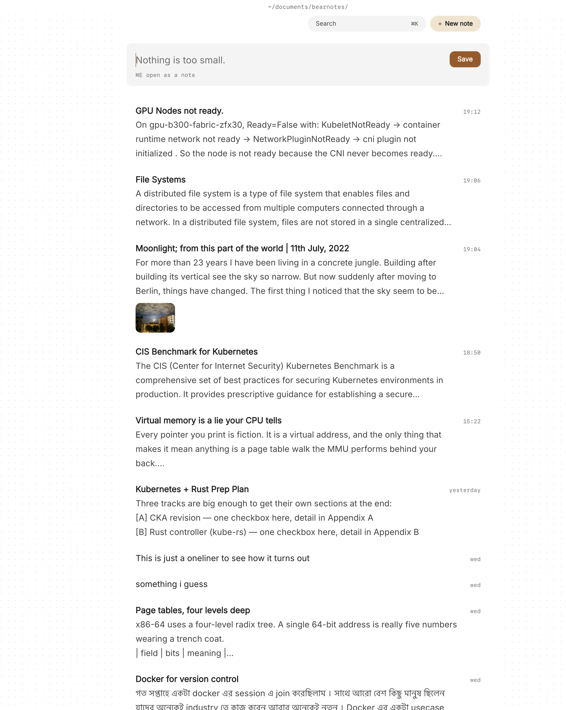

You've read Getting Things Done, maybe twice. You know the loop: capture everything, clarify what it means, put it where it belongs, review it every week, then do the work. The trouble is the tools. Your next actions live in a task app, the project support material lives in notes, and the two drift apart until the weekly review means reconciling three places.

A lot of GTD people end up wanting the opposite: notes and todos in the same files, with the action sitting right next to the thinking that produced it. Paperkites keeps every note as a plain markdown file on your Mac, treats any `- [ ]` line in any note as a todo, and gathers all of them into one list.

This article shows how to run a GTD system in Paperkites: the capture inbox, projects as notes, next actions as todos, and a weekly review you can actually finish.

## Setting up a GTD vault

Make a folder for the vault, for example `~/gtd`, and open it in Paperkites. Then give it a light structure:

- `projects/` holds one note per project, any outcome that takes more than one action.
- `reference/` holds material you want to keep but don't need to act on.
- `reviews/` holds one note per weekly review.

⌘\ shows the sidebar, with folders that mirror the vault on disk, so these three folders are always a keystroke away.

Contexts work well as nested tags. In GTD terms a context is where or with what you can do an action, so:

- `#at/computer`, `#at/calls`, `#at/errands`, `#at/home`
- `#waiting` for things you've handed to someone else
- `#someday` for the someday/maybe list

Put the context tag on the line with the todo or at the top of a note whose actions all share it. You can rename any of these later with ⌃r, which changes the tag in every file at once.

## The capture box as your inbox

GTD only works if capture is faster than forgetting. Paperkites opens on a capture box, which makes it a natural inbox:

1. Type the thought: "Ask the landlord about the boiler service".
2. Press ⌘↩. It's kept as a fragment, a short note without a title, and the box is empty again.
3. If the thought is already a project, press ⌘E instead to open it as a full note.

⏎ is a newline and never saves, and `esc` never throws a draft away, even if you quit. That matters for capture: nothing you start typing gets lost because you were interrupted.

Fragments land in the list, newest first, with the date shown once per day. That list is your in-tray until you process it.



## Clarifying and organizing, one item at a time

Processing the inbox is the step most systems make slow. In Paperkites it's a walk down the list with the keyboard. `j` and `k` move, ⏎ opens, and `[d` / `]d` jump a day at a time if the backlog is a few days deep. For each fragment, ask the GTD question: what is it, and is it actionable?

- **Not actionable, but useful.** Add a tag or move the text into a note in `reference/`. If it's a someday idea, tag it `#someday`.
- **One action.** Turn it into a todo: `- [ ] Call landlord about boiler service #at/calls`. If it takes less than two minutes, do it now and tick it with ⌘↩.
- **More than one action.** It's a project. Open or create the note in `projects/`, write the outcome at the top, and list the next action as a todo.
- **Someone else's move.** Write the todo with `#waiting` so it turns up when you search for what you're waiting on.

Links keep the project and its support material together. `[[Kitchen renovation]]` in a fragment ties it to the project note, and the project note's backlinks show the sentence each link sits in, so you can see every stray thought that mentions it.

## Next actions with :todos

Every todo in every note is part of one list. `:todos` shows them under four headings:

| Heading | What's in it |
|---|---|
| Overdue | Todos whose date has passed |
| Today | Todos dated today |
| Upcoming | Todos dated later |
| No date | Everything else |

In GTD terms, Today and Overdue are your hard landscape, the things that really are due, and No date is the bulk of your next actions. The [todos docs](/docs/todos) explain how to give a todo a date. Keep dates for real deadlines, as the book advises, and leave the rest undated.

When you sit down at a context, search for it. `/` searches the text of every note, and adding a tag narrows it, so `/` with `#at/calls` brings up every note with calls in it. ⌘K is the quicker route when you know the project's name.

`:daily` opens today's note, a good place for the day's short list and anything you capture while doing the work.

## An example project note

Here's a project note called Kitchen renovation in `projects/`, midway through:

```markdown
#project #home

Outcome: kitchen usable again with new worktops
and a working extractor, by the end of January.

Quotes and measurements are in [[Kitchen measurements]].
Budget thinking is in the 2 November review.

### Next actions
- [ ] Email two fitters for worktop quotes #at/computer
- [ ] Pick up tile samples from the builder's merchant #at/errands
- [ ] Ask the electrician about the extractor ducting #waiting
- [x] Measure the run from sink to wall

### Notes
- The extractor has to vent through the side wall,
  not the ceiling.
- Worktop: oak or laminate, decide after the quotes.
```

The outcome is written down, every action is a todo with a context tag, and the waiting item is marked so the weekly review catches it.

## The weekly review

GTD lives or dies on the weekly review, so make it a note and a routine. Open a new note in `reviews/` each week and work through it with the keys you already use:

1. **Get clear.** Empty the capture box and process every fragment in the list since last week. `[d` jumps back a day at a time until you reach the last review.
2. **Get current.** Open `:todos`. Clear anything Overdue: do it, redate it or delete it. Read Upcoming for the next week or two.
3. **Review projects.** Open each note in `projects/` from the sidebar and check that it has at least one open todo. A project with no next action is stuck.
4. **Check waiting-for.** Search `/` with `#waiting` and chase anything that's gone quiet.
5. **Review someday/maybe.** Search `#someday`. Promote anything that's now live into `projects/`.
6. **Tidy.** `#empty_kite` finds notes with no tags and `:orphans` finds notes nothing links to, which is where half-processed captures tend to hide.

Write a few lines in the review note as you go: what moved, what's stuck, what you dropped. Over months, those notes become a record of how your projects actually went. For a full list of keys, see [keys and commands](/docs/keys-and-commands).

For the reference side of the vault, the [Zettelkasten article](/usecase/zettelkasten-markdown-mac) covers linking ideas in more depth.

## Where Pro helps

The free app covers a working GTD system: capture, todos in any note, `:todos`, tags and search. Two Pro features match GTD closely:

- **Areas and projects** add Inbox, Today, Upcoming, Anytime, Someday and Logbook. Those map almost one to one onto GTD's in-tray, hard landscape, next actions, someday/maybe and done list. The [areas and projects docs](/docs/areas-and-projects) show how to set them up.
- **Task markers** add five states beyond open and done: scheduled, moved, cancelled, in progress and priority, picked with ⌘⇧↩. "Moved" and "cancelled" record a decision made in the weekly review instead of deleting the line, and "in progress" shows which projects are actually moving.

People pages with `@mentions` also help with waiting-for, since every sentence that mentions a person collects on their page. Pro is one payment with a 14-day trial, no card needed.

GTD is a habit, not an app: capture everything, decide what each thing is, keep the next action next to its project, and look at the whole system once a week. Keeping all of it in plain markdown files means the thinking and the doing stay in one place, and the weekly review becomes a walk through notes you already wrote.
