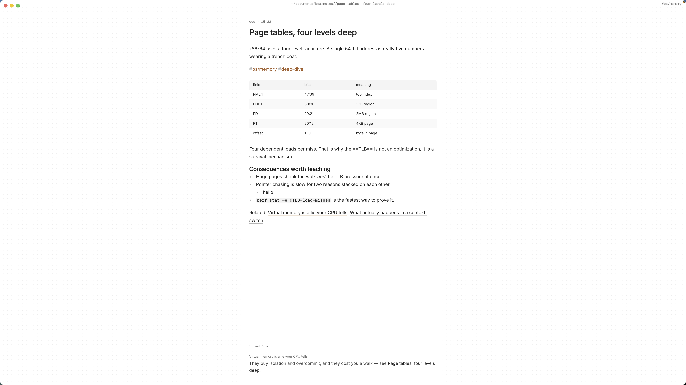

Learning a language produces a particular kind of mess. New words come from a lesson, a podcast, a menu, a message from a friend. Grammar explanations come from a textbook, a tutor and a forum thread that finally made the subjunctive click. Six months in, you know you've seen a word before but have no idea where you wrote it down.

Most of what you need is simple: a place to drop words the moment you meet them, a note per grammar point, and a way to tie a real sentence you heard to the rule that explains it. Language learning notes in plain markdown on your Mac do that well, because they're quick to write, easy to search and still readable in any editor years later.

This article shows how to set up Paperkites for learning a language, using Spanish as the example: vocabulary tables, grammar notes linked from example sentences, a daily note habit, and finding a word again with search.

## Setting up a vault for a language

A vault is a folder of `.md` files you choose. There's no account and no database. For one language, a few folders are enough:

- `vocab/` for vocabulary by topic: food, travel, work, feelings, verbs of motion
- `grammar/` for one note per grammar point: ser vs estar, preterite vs imperfect, the subjunctive, por vs para
- `daily/` for the notes `:daily` creates
- `sources/` for notes on a textbook unit, a series you're watching or a podcast

⌘\ shows the sidebar, with folders that mirror the vault on disk.

Tags give you a second way in. Use nested tags per topic and per kind: `#es/vocab/food`, `#es/vocab/travel`, `#es/grammar/subjunctive`, `#es/grammar/past`. If you learn more than one language, the top level (`#es`, `#de`) keeps them apart. A tag like `#tricky` for words you keep getting wrong costs nothing and pays off later.

Start with three notes: one vocabulary note for whatever you're studying this week, one grammar note for the point you're on, and today's daily note.

## A daily habit: capture, write, link

### Capturing words as you meet them

The app opens on a capture box. When you hear a word on a podcast or see it on a sign, type it with a rough meaning and press ⌘↩: "madrugada, the small hours, after midnight". It's kept as a fragment, a short note without a title. ⏎ never saves, and `esc` never throws a draft away, even across a quit. Later, you move fragments into the right vocabulary table.

### The daily note

`:daily` opens today's note. It's the core of the habit, and it works best when it's small:

- three to five new words, each in a sentence
- a few sentences of your own about the day, in the language
- one question for your tutor or for later

Writing your own sentences is where mistakes surface. When you notice one, link the rule that explains it right there in the sentence. `[[Preterite vs imperfect]]` after "Cuando era niño, vivía en Sevilla" means that grammar note will list this sentence in its backlinks.

The list shows everything newest first, with the date once per day. `[d` and `]d` jump back and forward by day, so last Tuesday's sentences are a few keypresses away.

### Vocabulary tables

Tables render in place, so a vocabulary note reads like a neat word list rather than pipes and dashes. Two or three columns work best: the word, its meaning, and an example or a note on gender and usage. `:format` tidies the table when it's grown unevenly. The [tables, diagrams and math docs](/docs/tables-diagrams-math) cover the table syntax.

### Grammar notes linked from real sentences

A grammar note holds the rule, a few clear examples, and the exceptions that tripped you up. The trick is that you rarely add examples to it directly. Instead, every daily note or vocabulary note that uses the rule links to it:

- `[[Subjunctive]]` links to the whole note.
- `[[Subjunctive#After ojalá]]` links to one heading inside it.
- `[[Por vs para|por]]` keeps the sentence natural while linking to the rule.

`gd` follows a link, `K` peeks at it without leaving the note, and ⌃o / ⌃i go back and forward. If you retitle a note, every link to it is rewritten; `:undo` reverts that.

### Practice tasks

Any line written as `- [ ]` is a todo, in any note. Use them for the small jobs a learner always has: "ask about leísmo", "rewrite Monday's paragraph", "listen to episode 12 again". ⌘↩ ticks one off, and `:todos` lists every open todo in the vault under Overdue, Today, Upcoming and No date. More in [how todos work](/docs/todos).

## An example: a daily note in Spanish

Here's a daily note a few months in, from someone at roughly intermediate level.

```markdown
# 2026-11-01

#es/daily #es/vocab/food

## Palabras nuevas

| Palabra | Meaning | Note |
|---|---|---|
| la madrugada | the small hours | feminine |
| el aguacate | avocado | |
| apetecer | to feel like | works like gustar: me apetece |

## Hoy
Ayer fui al mercado y compré aguacates. Cuando era niño,
no me gustaban nada. See [[Preterite vs imperfect]].

Ojalá que haga sol mañana. See [[Subjunctive#After ojalá]].

Me apetece un café. Same pattern as [[Gustar-type verbs]].

## Para mañana
- [ ] Ask my tutor why "me apetece" and not "apetezco"
- [ ] Move today's words into [[Food and cooking]]
- [x] Listen to the market episode again
```

Three sentences, three links. Each grammar note now holds a real sentence you wrote, in context, which is more memorable than a textbook example.

## Finding a word again

This is where plain text and fast search matter most, because the question is always "where did I see that word?"

- **`/`** searches the full text of every note, in under 100 ms on 10,000 notes. Type "madrugada" and every daily note, table and fragment that uses it comes back. Add a tag to narrow it: "apetecer `#es/grammar`" finds only the grammar notes that mention it.
- **⌘K** finds notes, fragments, tags and commands in one ranked list, in under 50 ms on 10,000 items. A few letters of a note title or a tag is enough.
- **Backlinks** at the foot of a grammar note show every sentence that links to it. Open `[[Subjunctive]]` and you get a list of your own sentences using it, gathered from months of daily notes. Reading them back is a quick review.
- **`:tags`** shows the tag tree. The page for `#es/vocab` lists its child tags, and a tag's page also shows the tags often used with it, so `#tricky` alongside `#es/grammar/past` tells you where your errors cluster.
- **⌃r** renames a tag in every file at once, for when `#spanish` becomes `#es`.
- **`:orphans`** finds notes nothing links to, such as a grammar note you wrote once and never used again.

The [finding docs](/docs/finding) list every option.



## Where Pro helps

Everything above is in the free core app. One Pro feature suits language learning: **the graph** (`:graph` or `gr`), a live canvas where tags are nodes and notes hang off the tags they carry. With topic tags for vocabulary and grammar, it shows which areas you've written a lot about and which you've barely touched. Pro is one payment with a 14-day trial, no card needed. If the trial ends without buying, Pro features go read-only and every note still opens.

## In short

Write a little every day, in sentences, and link each sentence to the rule it uses. Keep words in tables by topic and let search find them again. Over months, your grammar notes fill with examples you wrote yourself, and your daily notes become a record of how far you've come.
