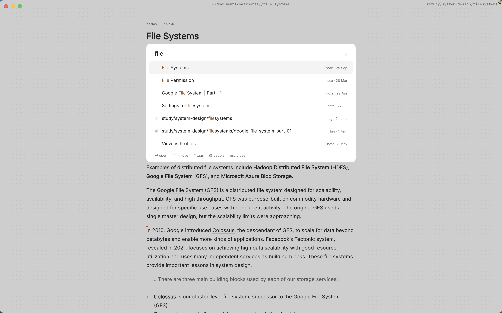

By October of your first year, you've briefed fifty cases and they've started to blur. You know there was a case about a promise to pay for a rescuer's injuries, and you know it matters for consideration, but the brief is in a document with forty others, and the professor's point about it is in a different file from a different week.

The case brief itself isn't the problem. The problem is that briefs get written one at a time, in reading order, while exams test them by doctrine. A good system keeps each case brief as its own note and links it to the doctrine it illustrates, so that when outlining starts, the doctrine note already knows every case that belongs under it.

This article shows how to write law school case briefs in markdown on your Mac with Paperkites, how to link them to doctrine and statute notes, and how backlinks turn that into the first draft of your outline.

## Setting up a vault for 1L

A Paperkites vault is a folder of plain `.md` files that you choose. No account, no database; you can open the same files in any text editor. One vault for law school works well, with a folder per course and a folder for doctrines:

- `contracts/cases/`, `torts/cases/`, `civpro/cases/`: one brief per case
- `contracts/doctrines/`, `torts/doctrines/`: one note per rule or test
- `statutes/`: one note per statute or rule you cite often, such as a section of the UCC or a Federal Rule of Civil Procedure
- `outlines/`: one outline per course, written near the end of term

⌘\ shows the sidebar, with folders that mirror the vault on disk.

Tags handle what folders can't. Nested tags such as `#contracts/consideration`, `#contracts/formation`, `#torts/negligence/duty` and `#civpro/jurisdiction` let a case sit under more than one topic. A few working tags help too: `#cold-call` for cases you were called on, `#split` for areas where jurisdictions disagree.

Start with one brief from this week's reading and one doctrine note for the rule it illustrates. Link them, and the pattern is set.

## A week of reading, briefing and class

### Briefing as you read

Open a new note per case and use the same headings every time: Facts, Procedural history, Issue, Holding, Reasoning, and Notes for whatever the professor adds. A consistent shape matters more than any template. Since Paperkites leaves front matter alone apart from `id`, `created` and `pinned`, you can also keep the court and year in front matter if you like.

The editor is live preview: only the block you're in shows its markdown, so a brief reads cleanly while you write it. `:zen` fades everything but the paragraph you're in, which helps with a dense opinion.

### Linking each case to doctrine and statute

The link is where a brief earns its keep. In the Reasoning section, link the rule the court applied:

- `[[Consideration]]` points at the doctrine note in `contracts/doctrines/`.
- `[[Promissory estoppel#Elements]]` links to a heading inside it, when the brief turns on one element.
- `[[UCC 2-207|battle of the forms]]` links to the statute note while keeping the sentence readable.

Link the cases to each other as well: a later case that distinguishes an earlier one should say so with a link. `gd` follows the link under the cursor, `K` peeks at it without leaving the brief, and ⌃o / ⌃i go back and forward.

If you rename a note, say from "Mutual assent" to "Offer and acceptance", every link to it across the vault is rewritten. `:undo` reverts it.

### In class

When the professor says something you don't want to lose, type it into the capture box and press ⌘↩. It's kept as a fragment, a short note without a title, ready to fold into the right brief after class. ⏎ never saves and `esc` never throws a draft away, even across a quit.

`:daily` opens today's note. A line per class works: what was covered, which hypotheticals came up, which cases the professor seemed to care about.

### Reading assignments and follow-ups

Any line starting with `- [ ]` is a todo. Put reading assignments in the daily note and follow-ups in the brief they belong to ("check how the dissent reads the statute"). ⌘↩ ticks one off. `:todos` lists every todo in the vault under Overdue, Today, Upcoming and No date, so reading for three courses ends up in one list. The [todos docs](/docs/todos) cover how dates are handled.

## An example note: a contracts case brief

Here's a brief in `contracts/cases/`. The case is a well-known teaching case on consideration and moral obligation; the details are summarized for study, not as legal advice.

```markdown
# Webb v. McGowin

#contracts/consideration #cold-call

Ala. Ct. App., 1935

## Facts
Webb was injured diverting a falling block to save McGowin.
McGowin then promised to pay him for life, and paid until
he died. His estate stopped paying.

## Issue
Is a promise made after receiving a material benefit
enforceable without bargained-for consideration?

## Holding
Yes. The material benefit supported the later promise.

## Reasoning
Departs from the usual [[Consideration]] rule; applies what
became the [[Material benefit rule]]. Contrast [[Mills v. Wyman]].

## Notes
- Professor: compare with [[Promissory estoppel#Elements]]
- [ ] Add the Restatement section to [[Material benefit rule]]
- [x] Reread [[Mills v. Wyman]] for the contrast
```

Three links tie the brief to two doctrines and a contrasting case. None of those notes need to mention this brief for it to show up on them.

## Backlinks and outlines before exams

Backlinks are the reason to brief this way. Open a doctrine note, and at the foot of it is every note that links to it, each shown with the sentence the link sits in.

Open `[[Consideration]]` in December and you'll see every brief from the term that applied, departed from or distinguished the rule, each with the line explaining how. That list is the skeleton of the consideration section of your outline, already sorted by what each case stands for. Statute notes work the same way: `[[UCC 2-207]]` collects every case that interpreted it.

`:orphans` finds notes nothing links to. A brief with no doctrine link is usually a case you read but never placed.

### Building the outline from doctrine notes

An outline is just another note in `outlines/`, organized by doctrine in the order the course taught it. Build it from the doctrine notes:

1. Open the doctrine note and its backlinks.
2. In a split (⌃w v), open the course outline beside it. ⌃w w moves between panes and ⌃w q closes one.
3. Write the rule, then list the cases from the backlinks under it with a one-line holding and a link back to the full brief.

Because each case is linked rather than copied, `K` on any case in the outline peeks at the full brief when you need the facts. More on panes in [the sidebar and splits](/docs/sidebar-and-split).

## Finding a case again

- **⌘K** finds notes, fragments, tags and commands in one ranked list, in under 50 ms on 10,000 items. Type part of a party name and press ⏎.
- **`/`** searches the full text of every note. Narrow it with a tag: "reliance `#contracts`" skips the torts briefs that use the same word.
- **`:tags`** shows the tag tree. The page for `#contracts/consideration` lists its child tags and the tags often used with it.
- **⌃r** renames a tag in every file at once, for when `#k` becomes `#contracts`.

See the [finding docs](/docs/finding) for every search option.



## Where Pro helps

The core app is free for good, and briefs, links, backlinks, tags and search are all in it. **The graph** (`:graph` or `gr`) is a Pro feature that fits law school well: a live canvas where tags are nodes and notes hang off the tags they carry, so you can see which doctrines your briefs cluster around and which tags barely have any. Pro is one payment with a 14-day trial, no card needed. If the trial ends without buying, Pro features go read-only and every note still opens.

## In short

Brief every case in the same shape, and link it to the doctrine and statute it applies. Do that through the term and the outline mostly writes itself: each doctrine note collects its cases in its backlinks, with the sentence that says why each one is there.
