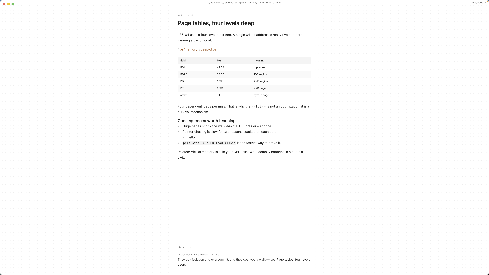

Medical school hands you more facts than any notebook can hold, and they refuse to stay in one place. Furosemide turns up in the cardiology lecture, again in renal, and once more in a pharmacology session three weeks later, each time with a slightly different angle. By the time exams come round, your notes on it are in three files, two slide decks and a margin.

What you want is simple to say: one note per condition, drug or mechanism, written once and linked from everywhere it matters. Medical school notes in plain markdown on your Mac can do that, and they stay readable in any editor long after the course is over.

This article shows how to set up Paperkites for lecture notes organised by system, how to link conditions to drugs and mechanisms, and how to turn a term of notes into a revision plan before exams.

## Setting up a vault for medical school

A Paperkites vault is a folder of `.md` files that you choose. There's no account and no database, so the folder itself is the structure. A layout that follows how most courses are taught:

| Folder | What goes in it |
|---|---|
| `lectures/` | One note per lecture, dated, in the order you sat them |
| `systems/cardio/`, `systems/renal/`, `systems/resp/` | Conditions and core physiology, one note each |
| `pharm/` | One note per drug or drug class |
| `revision/` | Exam plans, question bank logs, weak-topic lists |

⌘\ shows the sidebar, with folders that mirror the vault on disk.

Tags carry the second dimension. Nested tags let a note sit in a system and a topic at once: `#cardio/heart-failure`, `#renal/aki`, `#pharm/diuretics`, `#histo`, `#path`. Keep them few and predictable. A tag like `#exam/block2` on lecture notes is handy for pulling together everything a single exam covers.

Start with three notes: today's lecture, the main condition it covered, and the first drug that came up. The rest of the vault grows from the links between them.

## A week of lectures, linking and revision

### In the lecture

The app opens on a capture box. When the lecturer says something worth keeping that doesn't belong anywhere yet, such as "ask about the BNP cut-off in the tutorial", type it and press ⌘↩. It's kept as a fragment, a short note without a title. If a fragment grows, ⌘E opens it as a full note. ⏎ is only ever a newline and never saves, and `esc` never throws a draft away, even if you quit.

For the lecture itself, open a full note and write in the live-preview editor. Only the block you're in shows its markdown; the rest reads like a clean page. `:zen` fades everything but the paragraph you're typing, which helps when the slides are moving faster than you are.

### After the lecture: linking conditions, drugs and mechanisms

The lecture note is a record of what was said. The real work happens when you move each idea into the note it belongs to and link back:

- `[[Heart failure]]` points at the condition note in `systems/cardio/`.
- `[[Loop diuretics#Adverse effects]]` links straight to a heading inside the drug note.
- `[[Renin-angiotensin-aldosterone system|RAAS]]` keeps the sentence readable while linking to the full name.

`gd` follows the link under the cursor, `K` peeks at it without leaving the note, and ⌃o / ⌃i take you back and forward. That makes it quick to check a mechanism mid-sentence and return to where you were.

If you rename a note, say from "CCF" to "Heart failure", every link to it across the vault is rewritten. `:undo` reverts it if you change your mind.

### Tables for the things you compare

Much of medicine is comparison: drug classes, types of shock, nephritic versus nephrotic. Markdown tables render in place, so a comparison you build in week two is still there, tidy, in week twelve. `:format` straightens the pipes if a table gets messy. Mermaid diagrams work too, so a simple flowchart of a pathway can live in the note as plain text. The syntax is in [tables, diagrams and math](/docs/tables-diagrams-math).

### Images: anatomy and histology

Anatomy diagrams and histology slides are easier to remember than describe. Drag or paste a screenshot onto the note and it's copied into `attachments/` inside the vault, never moved and never written over another file. Several images sit side by side, each can be S, M, L or Full, and each can carry a caption, which is a good place for "H&E, note the ..." prompts to yourself. A large view shows the detail when you need it. More on this in [images and files](/docs/images-and-files).

### Revision todos

Any line written as `- [ ]` is a todo, wherever it sits: in a lecture note, a drug note or a revision plan. ⌘↩ ticks it off. Before an exam, `:todos` lists every todo in the vault under Overdue, Today, Upcoming and No date, so "redo the ECG questions" from week three doesn't stay buried in week three's lecture. The [todos docs](/docs/todos) explain how dated todos are sorted into those groups.

`:daily` opens today's note, which works well as a revision log: what you covered, what you got wrong, what to come back to.

## An example note: a condition, linked both ways

Here's a condition note in `systems/cardio/`, a few weeks into the cardiovascular block. The content is a study summary, not clinical guidance.

```markdown
# Heart failure

#cardio/heart-failure #exam/block2

Seen in [[2026-10-14 Cardio lecture 6]] and [[2026-10-21 Pharm lecture 3]].

## Mechanism
Reduced cardiac output triggers compensation via the
[[Renin-angiotensin-aldosterone system|RAAS]] and sympathetic
activation. Helpful short term, harmful over time.

## Drugs by role

| Role | Class |
|---|---|
| Symptom relief (fluid) | [[Loop diuretics]] |
| Blocks RAAS | [[ACE inhibitors]] |
| Rate and remodelling | [[Beta blockers]] |

## Images


## Revision
- [ ] Make the mechanism flowchart from memory
- [ ] Question bank: heart failure set, then review misses
- [x] Link every drug above to its own note
```

The drug notes link back in turn, so [[Loop diuretics]] shows heart failure in its backlinks without you writing that connection twice.

## Finding it again before exams

Months on, you'll remember a fact and not where you wrote it.

- **⌘K** finds notes, fragments, tags and commands in one ranked list, in under 50 ms on 10,000 items. Type "loop" and the drug note is in the list before you finish the word.
- **`/`** searches the full text of every note. Add a tag to narrow it: "hyperkalaemia `#pharm`" returns the drug notes that mention it, not every lecture that used the word.
- **Backlinks** at the foot of a note show the sentence each link sits in. Open "ACE inhibitors" and you see every condition, lecture and revision note that points at it, with the line around each link. That list is a ready-made revision sheet.
- **`:tags`** shows the tag tree. The page for `#cardio` lists its child tags and the tags often used with it, which quietly shows how your topics overlap.
- **⌃r** renames a tag in every file at once, for when `#cvs` becomes `#cardio`.
- **`#empty_kite`** finds notes with no tag, and **`:orphans`** finds notes nothing links to. Run both before an exam; an orphaned drug note is usually one you never connected to a condition.

For the full set of search options, see the [finding docs](/docs/finding).



## Where Pro helps

The core app is free for good, and everything above is in it. Two Pro features fit medical study well:

- **The graph** (`:graph` or `gr`) is a live canvas where tags are nodes and notes hang off the tags they carry. Seeing `#cardio` and `#renal` share a cluster of drug notes is a useful prompt for integrated questions.
- **Task markers** add five states beyond open and done: cancelled, moved, scheduled, in progress and priority (⌘⇧↩ picks one). Marking weak topics as priority keeps them at the front of a revision plan.

Pro is one payment with a 14-day trial, no card needed. If the trial ends without buying, Pro features go read-only and every note still opens.

## In short

Write each condition, drug and mechanism once, and link to it from every lecture that touches it. Keep images and tables next to the ideas they explain, put revision tasks where you notice the gap, and let backlinks build your revision sheets for you. By finals, the notes you need are the ones you already wrote, all in plain files on your Mac.
