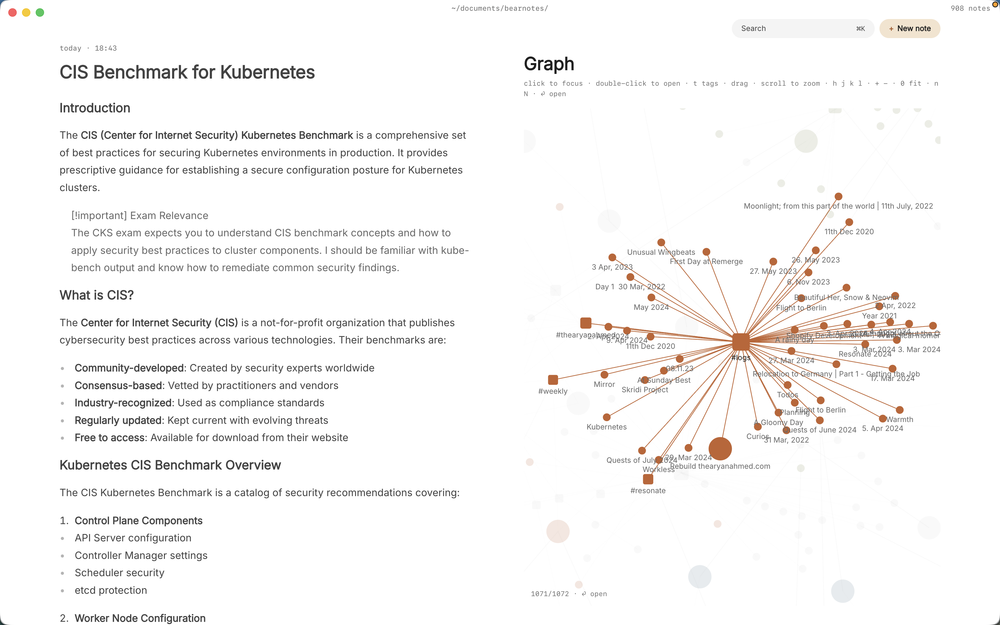

Somewhere around the third draft, a novel stops fitting in your head. You can't remember whether the ferryman's daughter was born before or after the flood, which chapter first mentions the salt tax, or why you renamed the eastern city and missed it in four places. The answers are in your notes, but your notes are a scrapbook: a document of character sketches, a spreadsheet timeline, a folder of loose scene ideas.

What you want is a worldbuilding wiki: one page per character, place and event, each linking to the others, so a question about one thread leads you straight to everything it touches. And you want it as plain files you own, not a project format that only one app can open.

This article shows how to keep novel worldbuilding notes in markdown on your Mac with Paperkites: setting up the wiki, drafting scenes in it, tracking revision passes, and finding the detail you need when you're deep in chapter twenty.

## Setting up a worldbuilding wiki

A Paperkites vault is a folder of `.md` files on your Mac, and nothing else. Make one for the book, say `~/Writing/The Salt Road`, and give it a few folders:

- `characters/`, one note per person in the story
- `places/`, for cities, houses, rivers and rooms that matter
- `timeline/`, one note per event or era
- `scenes/`, for drafts and fragments of the manuscript
- `revision/`, for your notes on each pass

⌘\ shows the sidebar, with folders that mirror the vault on disk, so the structure you see is the structure in Finder.

Then decide on a few nested tags. Folders say what a note is; tags say what it's about. A small set goes a long way:

| Tag | Use it for |
|---|---|
| `#thread/the-debt` | Every note touching one plot thread |
| `#pov/mara` | Scenes told from one point of view |
| `#draft/2` | Which draft a scene belongs to |
| `#canon` | Facts you've committed to |
| `#maybe` | Ideas you haven't |

The `#canon` and `#maybe` pair is worth the habit. Half of worldbuilding is remembering which version of a fact you settled on.

If you already keep a world in an Obsidian vault, Paperkites opens it as it is, links, embeds and callouts included.

## Writing the wiki and drafting the book

### Character and place notes

Start each character note with the facts you keep checking: age, where they live, what they want, who they owe. Link everything that has its own note. `[[Port Ellery]]` links to the place, `[[The Flood Year#Aftermath]]` links to a heading inside a timeline note, and `[[Mara Venn|Mara]]` lets the link read naturally in a sentence.

Characters in a novel aren't real people, so wiki links are the right tool for them. A character becomes a note in `characters/`, and every mention you link becomes a path back to that note.

The editor is live preview: only the block you're in shows its markdown, so a character sheet reads like a page, not like code. `gd` follows the link under the cursor and `K` peeks at it without leaving where you are, which is how you check a birth year mid-sentence. ⌃o takes you back.

### Renaming a character without breaking anything

Names change. When "Tomas" becomes "Teodor" in the third draft, retitle his note and Paperkites rewrites every link to it across the vault: the timeline, the place notes, the scene drafts that link to him. If you change your mind, `:undo` reverts it. The same goes for places and events.

Tags rename too. ⌃r renames a tag in every file at once, for when `#thread/the-debt` turns out to be `#thread/the-inheritance`.

### Drafting scenes in :zen

When it's time to write prose rather than notes about prose, open a scene and type `:zen`. Everything fades except what you're writing. The links and tags in the scene stay where they are, so you can still `K` to peek at a character when you need her eye color, then go straight back to the sentence.

Many novelists keep one note per scene, titled by what happens ("Mara finds the ledger"), with a `#pov/` tag and the draft number. Short scenes stay easy to move, and the list shows them newest first with the date once per day in the gutter, so `[d` and `]d` walk back through what you wrote day by day.

### Catching ideas without losing the thread

Ideas arrive at the wrong moment. The app opens on a capture box: type the line ("what if the ferryman knew about the ledger all along") and press ⌘↩. It's kept as a fragment, a short note without a title, and you're back to the scene. `esc` never throws a draft away, even across a quit. If the idea grows, ⌘E opens it as a full note.

### Revision passes as todos

Any line written `- [ ]` is a todo, wherever it sits. That suits revision, which is mostly a long list of small fixes scattered across a long manuscript. Put them where they belong: in the scene note when it's about that scene, in a `revision/` note when it's a whole pass ("Pass 3: tighten every chapter ending"). ⌘↩ ticks one off.

`:todos` gathers every open todo in the vault into one list, so the fix you noted in a character sheet two weeks ago shows up alongside the ones in your scene drafts. The [guide to how todos work](/docs/todos) covers the details.

## An example note: a character in the wiki

Here's a character note partway through a second draft:

```markdown
# Mara Venn

#canon #thread/the-debt #pov/mara

Ferryman's daughter, 34 at the start of the book. Grew up in
[[Port Ellery]], left after [[The Flood Year#Aftermath]].

## What she wants
To clear her father's name before the salt tax vote.

## Who she owes
- [[Teodor Ash]]: the passage money, never repaid
- [[The Harbour Guild]]: her father's licence

## Open questions
Did she see the ledger before chapter 9? #maybe

## Revision
- [ ] Make her age consistent in ch. 3 and ch. 14
- [ ] Cut the second flashback to the flood
- [x] Rename Tomas to Teodor everywhere
```

The links make this note a junction. Open Teodor Ash's note and its backlinks show the line from Mara's note where he appears, along with every scene that names him.

## Finding a detail again in chapter twenty

A worldbuilding wiki is only useful if answers come back quickly.

- **⌘K** finds notes, fragments, tags and commands in one ranked list. A few letters of a name and ⏎, and you're in the character sheet.
- **`/`** searches the text of every note. Add a tag to narrow it: "ledger" with `#thread/the-debt` skips every other ledger in the book.
- **Backlinks** at the foot of each note show the sentence each link sits in. Open a place and you see every scene and character that mentions it, in context, which is a fast continuity check.
- **`:tags`** shows the tag tree. A tag's page shows its child tags and the tags often used with it, so `#thread/the-debt` might show it travels mostly with `#pov/mara`, which tells you something about your structure.
- **`:orphans`** finds notes nothing links to. In a wiki that usually means a minor character you invented and then forgot, or a place you never used.
- **`#empty_kite`** finds untagged notes, often fragments you haven't sorted yet.

Splits help with continuity work: ⌃w v opens a second pane, so the timeline can sit next to the chapter you're checking against it. ⌃w w moves between them and ⌃w q closes one. There's more in [finding notes, tags and text](/docs/finding).

If you'd rather track what you read for the book than what you invent for it, the same tools work for [book notes in markdown](/usecase/book-notes-markdown-mac).

## Where Pro helps: the graph

The core app is free for good, and everything above is in it. One Pro feature suits a novel especially well.

**The graph** (`:graph` or `gr`) is a live canvas where tags are nodes and notes hang off the tags they carry. If you tag by thread and point of view, the graph shows the shape of your book: which threads have a dense cluster of scenes and characters, which ones have two lonely notes, and which characters sit between several threads. A thread that looks thin on the graph is often thin on the page. See [how the graph works](/docs/graph).



Pro also adds task markers, five todo states beyond open and done (cancelled, moved, scheduled, in progress, priority), useful when a revision note gets "moved" to the next pass rather than fixed now.

Pro is one payment with a 14-day trial, no card needed. If the trial ends without buying, Pro features go read-only and every note still opens.

## In short

Give every character, place and event its own note, link them as you write, and tag them by thread. Draft in `:zen`, leave revision todos where the problem is, and let backlinks do your continuity checking. By the final draft, the wiki is the memory you no longer have to keep in your head.
