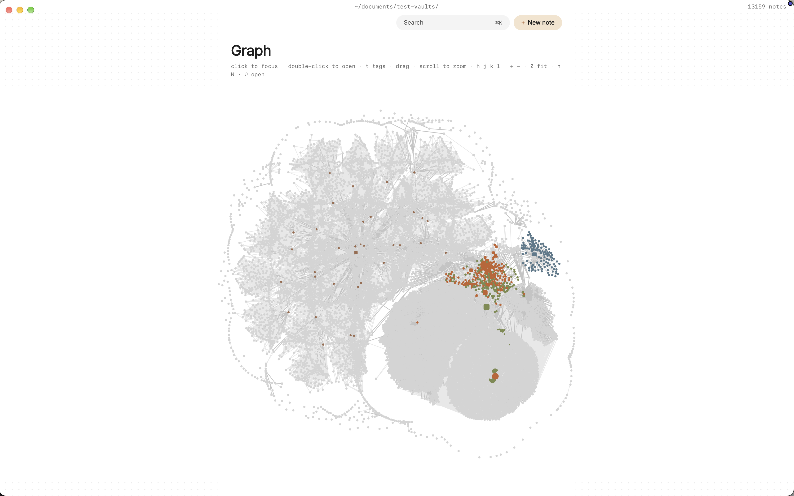

You've kept an Obsidian vault for years. It holds your reading notes, your project pages, a few Dataview tables you're quietly proud of, and a habit of linking that you'd never give up. Some days, though, you don't want to tend the system. You want to open the same files in a quieter Mac app, write with the keyboard, and get back out.

That's a reasonable thing to want, because an Obsidian vault is a folder of plain markdown files. Paperkites opens that folder as your vault without importing, converting or copying anything. Your links, embeds and callouts stay where they are, and you can keep Obsidian open on the same folder.

This article covers what opens as it is, what Paperkites writes to your files, and how to use both apps on one vault without them getting in each other's way.

## Opening an Obsidian vault in Paperkites

There's no import step and no account. Point Paperkites at the folder that holds your vault and it becomes the vault Paperkites works in. Every note stays a `.md` file in the place it already lives, and there's no database built beside it.

⌘\ shows the sidebar, with folders that mirror the vault on disk, so the structure you built in Obsidian is the structure you see. If you've organized by tags rather than folders, `:tags` shows the tag tree, nested tags like `#reading/papers` included.

Before you start writing, it helps to know which parts of your vault carry over. The [Obsidian docs page](/docs/obsidian) has the detail; the short version is this:

| In your vault | In Paperkites |
|---|---|
| `[[Note]]` links by path, file name, title or alias | Resolved as they are |
| Heading and block links, `[[Note#Heading]]`, `[[Note#^id]]` | Followed to the heading or block |
| Embeds, `![[Note]]` | Opened as embeds |
| Callouts, `==highlights==`, `%%comments%%`, footnotes | Kept and understood |
| `tags:` in front matter | Counted as the note's tags |
| Query, Dataview and Bases blocks | A subset of them runs |
| DataviewJS | Never run |

Two of those rows deserve a sentence each. Aliases matter because many vaults link to a person or concept by a short name set in `aliases:`; those links resolve in Paperkites too. And because only a subset of query, Dataview and Bases blocks runs, a dashboard note built on heavy queries may look different in Paperkites. The block is still there in the file, untouched. DataviewJS is never executed, which also means no script in a note runs when you open it.

## What Paperkites writes to your files

This is the question most vault owners ask first, and the answer is short. Paperkites leaves front matter alone apart from three keys it manages:

- `id`, a stable identifier for the note
- `created`, when the note was made
- `pinned`, set when you pin a note with `x` in the list

Everything else in your front matter, including `tags:`, `aliases:` and whatever properties your Obsidian setup relies on, stays as you wrote it. If you see those three keys in a note's properties in Obsidian, that's where they came from.

A few actions change note bodies, and only when you ask for them:

- **Retitling a note** rewrites every link to it across the vault, so `[[Old name]]` becomes `[[New name]]` in every file that pointed at it. `:undo` reverts it.
- **⌃r renames a tag** in every file at once.
- **`:format`** tidies the markdown of the note you're in.
- **Dropping or pasting an image** copies it into `attachments/` in the vault. It's never moved and never written over another file.

Nothing else is rewritten behind your back, and there's no analytics or telemetry. More on this in [how Paperkites treats your files](/docs/your-files).

## A day in Paperkites, with Obsidian still open

The point of a second app is to use it for the part of the day it suits. For most people moving between the two, that's capture and writing.

### Capturing without opening a note

Paperkites opens on a capture box. Type a thought and press ⌘↩ and it's kept as a fragment, a short note without a title. If it deserves a page of its own, ⌘E opens it as a full note instead. ⏎ is only a newline and never saves, and `esc` never throws a draft away, even if you quit. Fragments are ordinary files in the vault, so Obsidian sees them too.

### Moving through the vault with the keyboard

The list shows everything newest first, with the date once per day in the gutter. `j` and `k` move, `gg` and `G` jump to the ends, `[d` and `]d` jump a day at a time, ⏎ opens and `x` pins. Previews show a note's first lines, its todos and up to two images, so you can often read what you need without opening anything. A vault of 10,000 items scrolls without dropping frames.



### Writing and following links

The editor is live preview: only the block you're in shows its markdown. Vim keys are optional in `:settings`. Inside a note:

- `gd` follows the link under the cursor, `K` peeks at it in place, and ⌃o and ⌃i go back and forward.
- `[[Title|alias]]` and `[[Title#Heading]]` work as you'd write them in Obsidian.
- `:zen` fades everything but the paragraph you're writing.
- `:daily` opens today's note.

When you want to read one note against another, ⌃w v opens a split, ⌃w w moves between panes and ⌃w q closes one.

### Letting edits flow both ways

Edits made elsewhere show up in Paperkites while it's running. Write a paragraph in Obsidian, switch over, and it's there. Rename a note in Paperkites and the rewritten links are on disk for Obsidian to pick up. Both apps are reading and writing the same files, so the usual care applies: avoid typing in the same note in both apps at the same moment.

## An example note from a reading vault

Here's a note that came from Obsidian and opens in Paperkites as it is:

```markdown
---
tags: [reading/papers, distributed-systems]
aliases: [Raft paper]
id: 01JB6Q2Z8M
created: 2026-10-14
---

Raft splits consensus into leader election, log
replication and safety, which is why it's easier to teach
than [[Paxos Made Simple|Paxos]].

> [!quote] On understandability
> The primary goal was understandability. ^goal

==Election timeouts are randomized== to avoid split votes.
See [[Consensus#Failure modes]] and the summary in
![[Consensus reading list#Raft]].

%%Compare with the etcd notes before the reading group.%%

- [ ] Re-read section 5.4 on safety
- [x] Add to the reading group agenda[^1]

[^1]: Week of 3 November.
```

The `tags:` and `aliases:` lines came from Obsidian and stay untouched. The `id` and `created` lines are the ones Paperkites manages. The callout, the block id, the highlight, the comment, the heading link, the embed and the footnote all open as written, and the two todos appear in `:todos` alongside every other todo in the vault.

## Finding notes in a large vault

Long-running vaults get big, and finding things is where a keyboard-first app earns its place.

- **⌘K** lists notes, fragments, tags and commands in one ranked list, in under 50 ms on 10,000 items. Type part of a title or an alias and press ⏎.
- **`/`** searches the text of every note, in under 100 ms on 10,000 notes. Add `#reading/papers` to narrow it to a tag.
- **Backlinks** show the sentence each link sits in, so opening "Consensus" shows the line from the Raft note that points at it.
- **A tag's page** shows its child tags and the tags often used with it.
- **`#empty_kite`** finds notes with no tags and **`:orphans`** finds notes nothing links to, which in an older vault usually turns up a few forgotten drafts.

The [finding docs](/docs/finding) cover the rest.

## Where Pro helps

The core app is free for good, and everything above works without Pro. A few Pro features fit an Obsidian vault in particular:

- **Cloud folders** let the vault live in iCloud Drive, Dropbox, Google Drive or OneDrive, safe on more than one Mac. Many Obsidian vaults already sit in one of these.
- **The graph** (`:graph` or `gr`) is a live canvas where tags are nodes and notes hang off the tags they carry. It's a different view from a link graph, built around how your notes are tagged.
- **People** pages collect every sentence that `@mentions` a person note, with aliases, if you keep notes on colleagues or authors.

Pro is one payment with a 14-day trial, no card needed. If the trial ends without buying, Pro features go read-only and every note still opens.

## In short

Your vault is a folder of files, and more than one app can respect that. Keep building the system where you built it, and open the same folder in Paperkites when you want to capture, write and find things with the keyboard. The links, embeds and callouts stay where you put them, and the only lines Paperkites adds are `id`, `created` and `pinned`.
