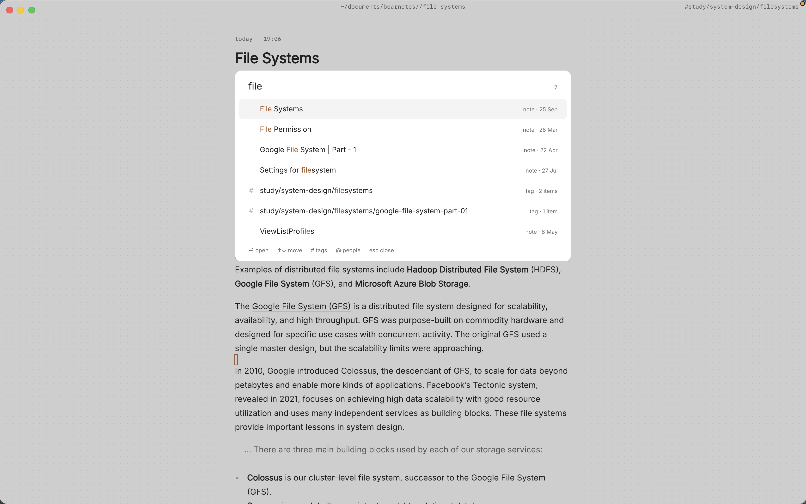

If you manage a team, your one-on-ones are where the real work of managing happens, and they are also the meetings you're most likely to lose track of. Six reports, a 1:1 with each every week or two, and by review season you're scrolling through a shared doc trying to remember when someone first said they wanted to lead a project, or whether you ever followed up on the on-call complaint.

The fix isn't a cleverer template. It's one note per meeting, written the same way every time, with a quick route from any person to everything you've written about them. Paperkites does that with plain markdown files in a folder on your Mac, and with Pro, a page per person that gathers every sentence that mentions them.

This article shows how to run one-on-one meeting notes in Paperkites: the setup, the weekly rhythm, an example note, and how to find a conversation from eight months ago.

## Setting up your 1:1 notes

A vault is a folder of `.md` files that you choose. It can be its own vault, say `~/management`, or a folder inside the vault you already use. Inside it:

- `1on1/` with a folder per report: `1on1/priya`, `1on1/marcus`, `1on1/lena`.
- `people/` for one person note each: role, start date, what they're working towards.
- `team/` for team meetings, retros and planning, where your reports come up too.

⌘\ shows the sidebar, with folders that mirror the vault on disk.

Name each meeting note the same way, such as `Priya 1:1 2026-11-04`. A fixed pattern means ⌘K finds them by name and date, and the list, which runs newest first with the date once per day, reads like a calendar of conversations.

Add a light set of tags: `#1on1`, plus a few for themes you want to see across the team, like `#growth`, `#workload` and `#feedback`. Keep it to a handful; you'll use them in search more than you'll browse them.

## Running a week of one-on-ones

### Before the meeting

Keep a running agenda note per report, pinned with `x` so it stays at the top of the list. During the week, when something comes up that you want to raise, add it there. The capture box is the fastest way: the app opens on it, you type the thought and press ⌘↩ to keep it as a fragment, then move it into the agenda later. ⏎ is a newline and never saves, and `esc` never throws a draft away, even across a quit.

Five minutes before the 1:1, open the agenda and last meeting's note side by side. ⌃w v opens a split, ⌃w w moves between panes and ⌃w q closes one. Last week's open todos are right there, so the meeting can start with "you were going to try pairing on the migration, how did it go?"

### During the meeting

Create the new note in the report's folder and write as you talk. The editor shows rendered markdown everywhere except the block you're in, so headings and lists stay readable while you type. If you'd rather not have anything else on screen, `:zen` fades everything but the text.

A short, repeated structure helps more than a long template: what they brought, what you brought, feedback both ways, and follow-ups. Link to things rather than re-explaining them: `[[Q4 on-call rota]]`, `[[Priya growth plan]]`.

### Follow-ups that don't slip

Write every follow-up as a todo in the meeting note, and make it clear whose it is:

- `- [ ] (me) Ask @marcus about pairing Priya on the billing migration`
- `- [ ] (Priya) Draft the RFC outline before next 1:1`

⌘↩ ticks one off. `:todos` lists every todo in the vault under Overdue, Today, Upcoming and No date, so your follow-ups from six different 1:1s land in one list instead of six notes. There's more in [how todos work](/docs/todos).

### After the meeting

Take two minutes to tag the note with any theme that came up and to move anything unresolved into the running agenda. That small habit is what makes the next meeting, and the next review, easy.

## An example note: a 1:1 with a direct report

```markdown
# Priya 1:1 2026-11-04

#1on1 #growth

## Priya brought
- Wants to lead the next platform project; see [[Priya growth plan]]
- On-call last week was rough: three pages after midnight
- Likes the pairing with @marcus, wants to keep it going

## I brought
- Feedback from @lena: the incident write-up was clear and fast
- Q4 priorities, linked in [[Q4 platform plan]]

## Feedback for me
- Planning meetings run long; send the agenda the day before

## Follow-ups
- [ ] (me) Raise the on-call load in [[Q4 on-call rota]]
- [ ] (me) Ask @marcus about pairing on the billing migration
- [ ] (Priya) Draft the RFC outline before next 1:1
- [x] (me) Share the promotion criteria doc
```

The wiki links tie the conversation to the plans it touches, so `Priya growth plan` collects a backlink from every 1:1 where her growth came up, each with the sentence around it.

## Finding past conversations

Review season, a promotion case or a hard conversation all start with the same question: what have we already talked about?

- **⌘K** finds notes, fragments, tags and commands in one ranked list. Typing "priya 1:1" brings up her meeting notes by date.
- **`/`** searches the text of every note. `@priya` narrows it to notes that mention her and `#growth` to a tag, so `on-call @priya` finds every time on-call came up with her, in 1:1s and in team notes alike.
- **Backlinks** at the foot of a note show the sentence each link sits in. `Q4 on-call rota` will show every 1:1 where someone raised it, which is a good signal before you change the rota.
- **`:tags`** shows the tag tree, and a tag's page shows the tags often used with it. If `#workload` keeps turning up next to the same project, that's worth knowing.

The [finding docs](/docs/finding) cover every option.



## Where Pro helps: people pages and locked notes

The core app is free for good, and everything above works without it. Two Pro features fit 1:1s closely enough to name.

### A page per person

With Pro, `@priya` points at Priya's person note, and aliases mean `@pri` can point there too. Each person gets a page with every sentence in the vault that mentions them, plus who and what often comes up with them. That covers her 1:1s, and also the team retro where someone thanked her and the planning note where you pencilled her in for a project. When you sit down to write a review, the page is your first draft of the evidence. See [people pages](/docs/people) for how mentions and aliases work.

### Locked notes for sensitive feedback

Some notes shouldn't sit readable on disk: a performance concern, a health conversation someone trusted you with, notes for a difficult decision. `:lock` encrypts a note with a password, and its text, tags, links and attachments are never stored readable. The password can't be recovered, so choose one you'll keep. A useful pattern is to keep the routine 1:1 note as an ordinary note and put the sensitive part in a separate locked note, so the everyday history stays easy to search.

Pro is one payment with a 14-day trial, no card needed. If the trial ends without buying, Pro features go read-only and every note still opens.

If you'd like the same people pages for stakeholders rather than reports, the [product manager notes](/usecase/product-manager-notes-mac) article shows that side of it.

## In short

One note per meeting, named the same way every time. Follow-ups as todos with an owner, themes as a few tags, and plans linked rather than retold. Keep it up for a few months and every report has a history you can read in minutes, which makes the next conversation, and the next review, fairer to them.
