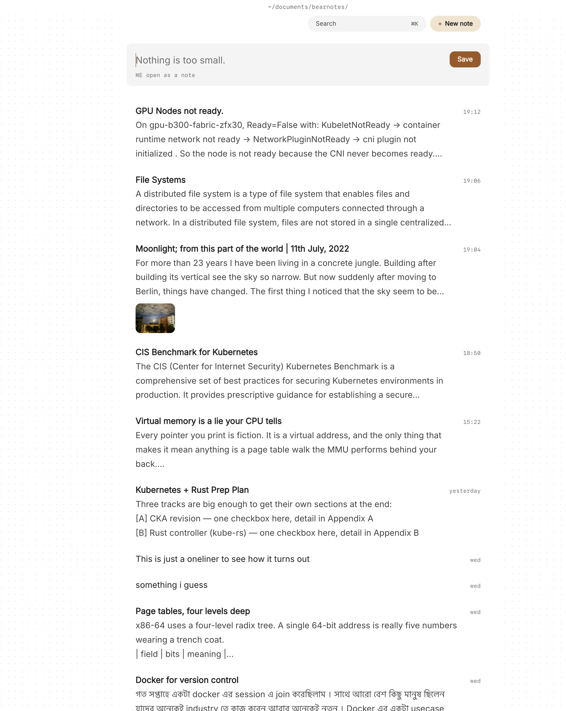

You've probably kept a journal before, more than once. A paper notebook that ended up in a drawer, a folder of text files named by date, an app that asked for an account before you'd written a word. The habit faded, or the place you kept it stopped feeling like yours.

A journal is the one thing you write that nobody else is meant to read. It should be quick to open, quiet to write in, and kept somewhere you control. Paperkites stores every note as a plain markdown file in a folder on your Mac. There's no account to make, no analytics and no telemetry, so a private journal in markdown stays on your disk, in files any text editor can open for as long as you keep them.

This article shows how to set up a journal in Paperkites, what a day of journaling looks like, from the morning entry to the thought that turns up at 11pm, and how to keep the most private pages encrypted.

## Setting up a journal vault

A vault is a folder of `.md` files. You can keep your journal in its own vault or as a folder inside a bigger one. A separate vault keeps it out of your work searches entirely, which most people prefer.

1. Make a folder such as `~/Journal` and open it as your vault.
2. Add a folder or two only if you want them, for example `letters` for the ones you'll never send. ⌘\ shows the sidebar, with folders that mirror the vault on disk.
3. Choose a few tags you'll really use. Nested tags keep them tidy: `#mood/low`, `#mood/good`, `#health/sleep`, `#family`, `#gratitude`.
4. Open `:settings` and make the page comfortable to sit with: light, dark or auto, a font and size you like reading, line spacing and width. Spell check is there if you want it, or off if red underlines pull you out of the sentence.

That's the whole setup. There's nothing to sign into and nothing to decide about where your writing goes, because it goes nowhere but the folder. [How Paperkites treats your files](/docs/your-files) explains exactly what it writes and what it leaves alone.

## A day of journaling

### The morning entry

Type `:daily` and today's note opens. It's one page for the day, so coming back at lunch or before bed adds to the same entry rather than scattering the day across several.

If a blank page makes you stall, give the entry a loose shape you're free to ignore: a line about how you slept, what's on your mind, one thing you're looking forward to. On days you just want the words, `:zen` fades everything except what you're writing.

The editor is live preview. Only the paragraph you're in shows its markdown, so a heading or an italic phrase looks like itself as soon as you move on. You write in plain text and read something that looks like a page.

### Thoughts that arrive between entries

Most of what's worth writing down doesn't arrive at a convenient time. The app opens on a capture box for exactly this. Type the thought and press ⌘↩: it's kept as a fragment, a short note with no title, and the box is clear again. Nothing to name, nothing to file.

Two details make the box safe for half-formed thoughts. ⏎ only starts a new line and never saves, so you can write three lines without committing early. And `esc` never throws a draft away, even if you quit mid-sentence; it's waiting when you come back.

If a fragment grows into something longer as you type, ⌘E opens it as a full note instead.

### Reading back by day

The list shows everything, entries and fragments together, newest first, with the date once per day in the gutter. It reads like a diary because it is one.

| Keys | What they do |
|---|---|
| `j` / `k` | Move down and up one item |
| `[d` / `]d` | Jump back or forward a whole day |
| `gg` / `G` | Go to the top or the bottom |
| ⏎ | Open the entry |
| `x` | Pin it, to keep it near the top for a while |

Previews show each note's first lines, its todos and up to two images, so scrolling back through a month gives you its shape without opening every page. Pressing `[d` a dozen times on a bad week and seeing that it didn't last is its own kind of comfort.

### The small things to act on

Journaling turns up things to do: ring your sister, book the dentist, take back the library books. Write them as `- [ ]` lines where they come up. ⌘↩ ticks one off, and `:todos` gathers every todo in the vault in one list, so the promise you made yourself on Tuesday doesn't stay buried in Tuesday.

### Photos

Drag or paste a photo onto an entry and it's copied into the vault's `attachments/` folder; the original is never moved. Choose a size (S, M, L or Full) and add a caption if the picture needs one. Several photos sit side by side.

## An example entry

Here's a Sunday entry, written in two sittings:

```markdown
# Sunday, a slow one

#mood/good #health/sleep

Slept nine hours for the first time in weeks. Walked to the
river before anyone was up, and the heron was back on the
same post as last spring.

Still turning over what Mum said on the phone. I've started
writing it out properly in [[Letters to Dad]].

## Grateful for
- Coffee on the back step
- An afternoon with nowhere to be

## To do
- [ ] Ring Mum back on Wednesday
- [x] Take the library books back
```

The tags let you find the good-sleep days later, the wiki link ties the entry to the longer piece it started, and the todos turn up in `:todos` until they're done.

## Finding an old entry again

A journal you can't search is a box in the loft. A few ways back in:

- **`/`** searches the text of every note, in under 100 ms on 10,000 notes. Type "heron" and every morning you mentioned it comes back. Add `#mood/low` to narrow a search to the harder days.
- **⌘K** finds notes, fragments and tags by any word in the title, in one ranked list.
- **`:tags`** shows the tag tree. A tag's page shows its child tags and the tags most often used with it. If `#mood/low` keeps turning up alongside `#health/sleep`, that's worth knowing, and you didn't have to build a chart to see it.
- **Backlinks** at the foot of a note show the sentence each link sits in, so opening "Letters to Dad" shows every entry that led to it.

The [finding docs](/docs/finding) cover every search option.



## Keeping some entries locked

Some pages should never sit as readable text, even on your own disk: things about your health, your relationship, other people's confidences. With Pro, `:lock` encrypts a note with a password. Its text, tags, links and attachments never sit readable on disk, so anyone browsing the folder sees nothing they can read.

Be clear about the trade-off before you use it. **The password can't be recovered.** There's no reset email and no account to recover it through, because there's no account. If you forget it, the note stays encrypted for good. Choose a password you'll remember, or keep it wherever you already keep passwords you trust, and lock only the entries that need it rather than the whole journal. The [locked notes docs](/docs/locked-notes) go through how it works.

## Where Pro helps

The core app, including `:daily`, fragments, tags, search and todos, is free for good. Two Pro features fit a journal:

- **Locked notes**, as above, for the entries that should stay unreadable on disk.
- **Cloud folders**, if you write on more than one Mac. Your vault can live in iCloud Drive, Dropbox, Google Drive or OneDrive and stay safe across your Macs. If you'd rather your journal never leaves this one machine, skip it; a local folder works just as well.

Pro is one payment with a 14-day trial, no card needed. If the trial ends without buying, Pro features go read-only; every note still opens and nothing is locked away.

## In short

Write a little most days, catch the stray thoughts as fragments when they come, and lock the few pages that need it. Keep it all in a folder you own, as plain text you could read in any editor. Years from now, `[d` and a search for one remembered word will take you back to the morning the heron returned.
