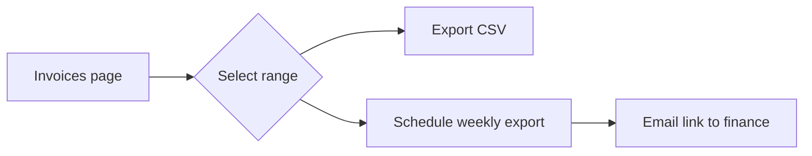
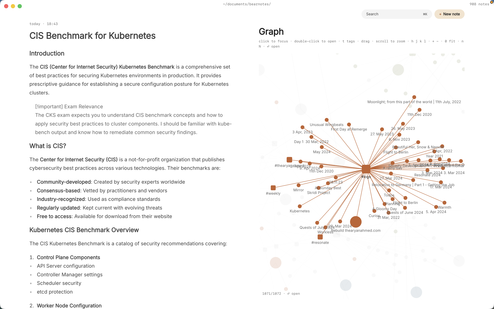

As a product manager you write all day, but rarely in one place. Standup notes go in one doc, the spec lives in another, customer calls end up in a ticket tracker, and the reason you dropped bulk export in March is somewhere in a chat thread you'll never find again. When a stakeholder asks "why did we decide this?", you end up rebuilding the answer from memory.

What you want is simple: product manager notes that are quick to take in a meeting, easy to link to the spec they affect, and still readable in five years. Paperkites keeps every note as a plain markdown file in a folder on your Mac, with wiki links, backlinks and full-text search across all of it.

This article shows one way to set it up: meeting notes, a decision log, specs with Mermaid flows, and customer feedback that points at the features it's about.

## Setting up a vault for product work

A vault is a folder of `.md` files. Make one, say `~/product`, open it in Paperkites, and add a few folders that match the shape of the job:

| Folder | What goes in it |
|---|---|
| `meetings/` | Standups, reviews, stakeholder syncs |
| `decisions/` | One note per decision, with the date in the title |
| `specs/` | One note per feature or initiative |
| `feedback/` | Customer calls, support themes, sales notes |

⌘\ shows the sidebar, with folders that mirror the vault on disk. Add a small set of nested tags on top: `#area/checkout`, `#area/onboarding`, `#feedback/enterprise`, `#feedback/self-serve`. Folders say what kind of note something is; tags say which part of the product it touches. A customer call about invoices can then sit in `feedback/` and still show up under `#area/checkout`.

## A week of it: meetings, decisions and specs

### Taking meeting notes as they happen

The app opens on a capture box. In a hallway conversation or the last minute of a call, type the point and press ⌘↩: it's kept as a fragment, a short note without a title. When a meeting deserves a proper record, ⌘E opens what you've typed as a full note instead. ⏎ is a newline and never saves, and `esc` never throws a draft away, so an accidental keypress mid-meeting costs you nothing.

For the daily rhythm, `:daily` opens today's note. It works well as a running log: standup blockers, who you need to chase, and links out to the bigger notes you wrote that day.

### Keeping a decision log

Decisions are what a product manager gets asked about most and remembers least. Give each one its own note in `decisions/`, titled like `2026-10-14 Drop bulk export from v2`, with a short fixed shape: context, options, what you chose, and who agreed. Then link it from wherever it matters. The spec gets `[[2026-10-14 Drop bulk export from v2]]`, and so does the meeting where it was settled.

Because backlinks show the sentence each link sits in, the decision note collects its own history. Open it a year later and the foot of the note lists every meeting, spec and feedback note that refers to it, each with the line around the link.

### Writing specs with Mermaid flows

Specs live in `specs/`, one per feature. The editor shows rendered markdown everywhere except the block you're in, so a spec reads like a document while you write it. Tables work for requirements and scope, and Mermaid diagrams render right in the note, which suits user flows and state changes. The syntax is covered in [tables, diagrams and math](/docs/tables-diagrams-math).

Link liberally. `[[Checkout redesign#Open questions]]` points at a heading inside a spec. `K` peeks at a link without leaving the note you're in, and `gd` follows it. If a feature gets renamed halfway through, retitle the spec and every link to it across the vault is rewritten; `:undo` reverts that if you change your mind.

### Linking customer feedback to features

This is where plain notes earn their keep. After each customer call, write a note in `feedback/` and link the features it touches: "They export invoices every Friday and paste them into a spreadsheet, see [[Invoice export]]." Do that for every call and the `Invoice export` spec quietly gathers its evidence. Its backlinks become a list of real sentences from real calls, which is exactly what you need when you're arguing for priority in planning.

Splits help here. ⌃w v opens a second pane, so the spec sits on one side and the feedback note you're writing sits on the other. ⌃w w moves between them and ⌃w q closes one.

### Tracking action items

Any line that starts with `- [ ]` is a todo, in any note. ⌘↩ ticks it off. `:todos` gathers every todo in the vault under Overdue, Today, Upcoming and No date, so the follow-up you promised in Tuesday's review is in the same list as the one buried in a spec. See [how todos work](/docs/todos) for the details.

## An example note: a feature spec

````markdown
# Invoice export

#area/checkout #spec

Status: drafting, target Q1 review with @dana

## Problem
Finance teams re-key invoices into spreadsheets every week.
Raised in nine calls since August, mostly #feedback/enterprise.
See [[Acme call 2026-10-02]] and [[Northwind call 2026-10-20]].

## Flow


## Decisions
- Scheduled export is v2, see [[2026-10-14 Drop bulk export from v2]]

## Next
- [ ] Confirm CSV columns with @priya from billing
- [ ] Review flow with @dana before Friday
- [x] Pull ticket counts for export requests
````

The Mermaid block renders as a diagram under Flow. The feedback notes it links to will list it among their backlinks, and the decision note will too.

## Finding it again with search, tags and backlinks

Six months on, most questions start with a half-remembered word.

- **⌘K** finds notes, fragments, tags and commands in one ranked list. Type "invoice" and the spec, the calls and the decision are all there.
- **`/`** searches the full text of every note. Add `#feedback/enterprise` to see only what enterprise customers said, or `@dana` to see only what involved Dana.
- **`:tags`** shows the tag tree. A tag's page lists its child tags and the tags most often used with it, which is a quick read on which product areas generate the most feedback.
- **`:orphans`** finds notes nothing links to. Feedback notes that never got tied to a feature show up here, which makes it a useful weekly sweep.

The [finding docs](/docs/finding) cover every search option.



## Where Pro helps

The core app is free for good, and everything above works without paying. Three Pro features fit product work closely:

- **People.** `@dana` points at a person note, with aliases, and each person gets a page with every sentence that mentions them and who and what often comes up with them. Before a stakeholder sync, that page is the briefing: every open question, request and promise in one list. If you also run 1:1s, the [one-on-one meeting notes](/usecase/one-on-one-meeting-notes-mac) article goes further into this.
- **Areas and projects.** An area per product area and a project per initiative, with Inbox, Today, Upcoming, Anytime, Someday and Logbook views, so the work behind your notes has a shape.
- **The graph.** `:graph` or `gr` shows tags as nodes and notes hanging off them. With `#area/` and `#feedback/` tags, you can see at a glance which parts of the product your notes and calls cluster around.

Pro is one payment with a 14-day trial, no card needed. If the trial ends without buying, Pro features go read-only and every note still opens.

## In short

Write the meeting note while it's happening, give every decision its own note, and link each piece of customer feedback to the feature it's about. Do that for a quarter and the vault answers "why did we build it this way" on its own, one backlink at a time.
