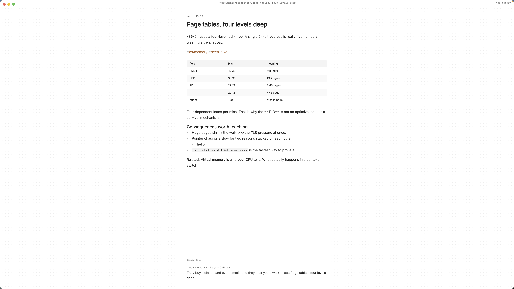

The recipes you actually cook are scattered. A few are bookmarked on sites buried under life stories and pop-ups, a few are photos of a cookbook page, and the best ones are in your head, with the changes you've made over the years that nobody wrote down. When someone asks for your dal, you realise the version you make is not the version you saved.

A recipe collection in plain markdown fixes that. Each recipe is a small text file you own, with the ingredients in a table, a photo of how it should look, and your notes on what you changed. It opens in anything, it'll still open in twenty years, and it doesn't need an account.

This article shows how to build a recipe collection in markdown on your Mac with Paperkites: setting up the folders and tags, writing recipes, keeping a shopping list, and finding tonight's dinner by cuisine, season or a single ingredient.

## Setting up your recipe collection

Paperkites keeps every note as a plain `.md` file in a folder you choose, your vault. For recipes, a few folders are enough:

- `recipes/`, one note per dish
- `changes/`, notes on what you changed and how it went
- `plans/`, for the week's menu and the shopping list

⌘\ shows the sidebar, with folders that mirror the vault on disk.

Folders hold the recipes; tags are how you find them. Nested tags keep cuisine, season and course apart:

| Tag | Use it for |
|---|---|
| `#cuisine/indian` | Where the dish comes from |
| `#cuisine/italian` | Another cuisine |
| `#season/autumn` | When it's at its best |
| `#course/main` | Main, side, dessert, bread |
| `#weeknight` | Under 40 minutes, start to finish |
| `#tried-and-true` | The ones you'd make for guests |

Multi-word tags work too, written with a closing `#`: `#sunday lunch#`.

## A week of cooking with your notes

### Writing a recipe

Make a note in `recipes/` titled with the dish: `Tarka dal`. The editor is live preview, so only the line you're on shows its markdown, and the rest reads like a recipe card.

Put the ingredients in a table: quantity, ingredient, and a note column for the things that matter ("split, not whole"). Tables keep long ingredient lists easy to scan from across the kitchen. Then the method as a numbered list, short steps, one action each. See [tables, diagrams and math](/docs/tables-diagrams-math) for the table syntax.

### Adding photos of the dish

Drag a photo of the finished dish onto the note, or paste it. It's copied into an `attachments/` folder inside the vault, never moved from where it was and never written over another file. If you have a few (the tarka at the right colour, the finished bowl), they show side by side. Each image can be shown at S, M, L or Full and can take a caption, so "this is the colour the onions should be" sits under the picture of the onions.

A photo of a handwritten family recipe works the same way: keep the image as the original and type the recipe out beneath it, so it can be searched. More in [images and files](/docs/images-and-files).

### Recording what you changed

Recipes drift. You halve the chilli, swap the tinned tomatoes for fresh in August, find that the bread needs ten minutes less in your oven. Rather than editing the recipe each time, keep a `changes/` note per dish, `Tarka dal: what I changed`, and log each attempt under a dated heading: what you did, how it came out.

Link the two. In the changes note, `[[Tarka dal]]` points at the recipe; in the recipe, `[[Tarka dal: what I changed]]` points back. Backlinks at the foot of the recipe show the sentence each link sits in, so the recipe always shows that there's history to read. When a change becomes the way you always make it, fold it into the recipe and say so in the log.

If you rename a recipe, say `Dal` becomes `Tarka dal`, every link to it is rewritten. `:undo` reverts that if you didn't mean it.

### The shopping list

Make a note in `plans/` called `Shopping list`. Each item is a todo: `- [ ] 2 lemons`. ⌘↩ ticks one off. Add things as you run out, and add a recipe's ingredients when you plan to cook it.

Todos don't have to live in the shopping list, though. Any line written `- [ ]` is a todo wherever it sits, so the week's menu note can carry its own ("buy paneer for Thursday"), and a recipe can carry one too ("find whole asafoetida, not the powder"). `:todos` lists every todo in the vault in one place, under Overdue, Today, Upcoming and No date, which in practice is your full shopping list, gathered from every note that mentions something to buy. There's more on [how todos work](/docs/todos).

### Quick capture in the kitchen

The app opens on a capture box. Out of rice, or a thought about tonight's dish ("more lemon at the end"): type it and press ⌘↩. It's kept as a fragment, a short note without a title. ⏎ is a new line and never saves, and `esc` never throws a draft away. Later, move the line to the right note.

## An example recipe note

```markdown
# Tarka dal

#cuisine/indian #course/main #weeknight #season/autumn #tried-and-true

Serves 4. About 35 minutes.
What I've changed over time: [[Tarka dal: what I changed]]

## Ingredients

| Amount | Ingredient | Note |
|---|---|---|
| 250 g | red lentils | rinsed until clear |
| 1 tsp | turmeric | |
| 2 tbsp | ghee | or oil |
| 1 tsp | cumin seeds | |
| 1 | onion | thinly sliced |
| 3 cloves | garlic | sliced |
| 2 | dried red chillies | one if cooking for kids |
| 1 | lemon | juice, at the end |

## Method
1. Simmer lentils with turmeric and 800 ml water, 20 min.
2. Heat ghee, add cumin until it crackles.
3. Add onion, cook until deep golden, then garlic and chillies.
4. Pour the tarka over the dal. Lemon, salt, stir.

## To buy
- [ ] red lentils
- [ ] lemons
```

The two todos under "To buy" will also show up in `:todos`, next to everything on the main shopping list.



## Finding a recipe again

When you're standing at the fridge, finding the right recipe needs to be quick.

- **⌘K** finds notes, fragments, tags and commands in one ranked list. A few letters of the dish, ⏎, and it's open.
- **`/`** searches the text of every note, so you can search by ingredient. "squash" finds every recipe with squash in it; add `#weeknight` to keep it to the quick ones.
- **`:tags`** shows the tag tree. Open `#season/autumn` and its page shows its child tags and the tags often used with it, which tells you what kind of autumn cooking you tend to do.
- **The list** shows everything newest first, with previews of each note's first lines, its todos and up to two images, so scrolling it feels a bit like flicking through a cookbook.
- **`x`** pins a note. Pin the shopping list and this week's menu so they stay at hand.
- **`#empty_kite`** finds untagged notes, usually recipes you saved in a hurry.

Splits help when cooking two things at once: ⌃w v opens a second pane, ⌃w w moves between them, and ⌃w q closes one.

If you plan meals the same way you plan everything else, the shopping list fits into a wider [GTD system of notes and todos](/usecase/gtd-notes-and-todos-mac).

## Where Pro helps

The core app is free for good, and everything above is in it. One Pro feature is worth knowing about for recipes.

**Cloud folders** let you keep the vault in iCloud Drive, Dropbox, Google Drive or OneDrive, safe on more than one of your Macs. If you write recipes at the desk and cook with a laptop on the counter, that's the piece that joins them.

Pro is one payment with a 14-day trial, no card needed. If the trial ends without buying, Pro features go read-only and every note still opens.

## In short

Write each recipe down once, in a file you own, with a photo of how it should look. Keep what you changed in its own note, linked to the recipe, so your version is never lost. Tag by cuisine and season, keep the shopping list as todos, and let `:todos` gather what you need to buy.
