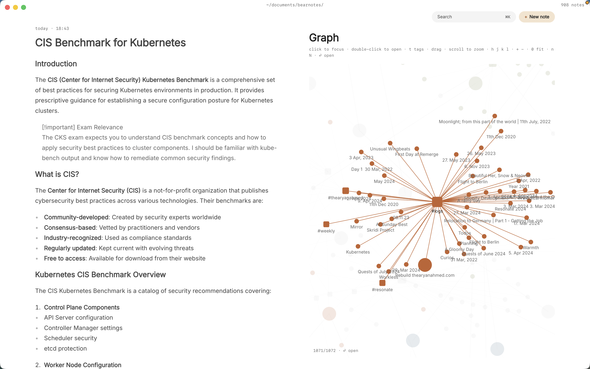

You're two years into a PhD in history, sociology or something in between. You have two hundred sources, a few thousand photos from three archive trips, interview transcripts, and a chapter plan that changes every time you meet your supervisor. Your notes on all of it are split between a reference manager, a folder of documents named `notes_FINAL_v3`, and a phone full of pictures of box labels.

The thesis gets written somewhere else, but the thinking happens in your notes, and the thinking is what keeps getting lost: which source said what, on which page, and which argument it was going to support. Paperkites keeps every note as a plain markdown file in a folder on your Mac, so a research notebook in markdown stays readable for the whole PhD and long after, whatever software you use for the thesis itself.

This article shows how to set up the notebook, how to take source notes that keep their provenance, how to tie sources to the arguments in each chapter, and how to find things again in year four.

## Setting up the research notebook

Make a folder such as `~/Thesis-notes` and open it as your vault. A few folders match how a humanities or social science project actually runs:

- `sources/` with one note per source: a book, an article, an archive file, an interview.
- `archive/` for archive-trip logs and the photos that go with them.
- `chapters/` with one note per chapter, holding its argument and outline.
- `claims/` for short notes that each state one argument you want to make.

⌘\ shows the sidebar, with folders that mirror the vault on disk.

Paperkites doesn't connect to a reference manager. What works well is putting the citation key from your reference manager in each source note's front matter, so the note and the bibliography entry share a name. Paperkites leaves your front matter alone apart from the three fields it manages (`id`, `created` and `pinned`).

Then sketch a tag tree. Nested tags grow with the project:

| Tag | What it marks |
|---|---|
| `#source/archive`, `#source/secondary`, `#source/interview` | What kind of source it is |
| `#ch/2`, `#ch/3` | Which chapter it feeds |
| `#theme/labour`, `#theme/migration` | The themes you're tracing |

When the chapter plan changes and chapter 3 becomes chapter 4, ⌃r renames a tag in every file at once.

## A week of research

### Source notes with provenance

Every quote in a source note carries where it came from: page number for a book, box, folder and item for an archive document, timestamp for an interview. You'll thank yourself when you're writing the footnote at midnight.

Keep the source's words and yours visibly apart. Quotes go in `>` blockquotes; your reading goes underneath in plain text. Footnotes (`[^1]`) are good for the provenance details that would clutter the line: the condition of the document, a note on an uncertain reading, the archivist who pointed you to it.

### Archive days

On an archive trip, `:daily` opens today's note, a natural place for the day's log: which boxes you ordered, what was in them, what to request tomorrow.

Photos of documents go straight onto the note. Drag or paste them and they're copied into the vault's `attachments/` folder, never moved and never written over another file. Several images sit side by side; set each to S, M, L or Full, give it a caption with the box and folder reference, and open the large view when you need to read a faded hand. More on this in [images and files](/docs/images-and-files).

For the half-thought you have while waiting for a box, the app opens on a capture box: type it, press ⌘↩, and it's kept as a fragment, a short untitled note. ⏎ is a new line and never saves, and `esc` never throws a draft away. ⌘E opens it as a full note if it's going to be more than a line.

### Linking sources to arguments

The work of a thesis is joining evidence to claims. Each note in `claims/` states one argument and links to the sources that support or complicate it:

- `[[Title]]` links to a source note; `[[Title|alias]]` lets you write `[[Hartley 1974|Hartley]]` so the sentence reads normally.
- `[[Title#Heading]]` links to one heading in a long source note, such as the section on a particular strike.
- `gd` follows a link and `K` peeks at it without leaving the note, so you can check a quote while writing the claim. ⌃o and ⌃i go back and forward.

Each chapter note then links to its claims in the order the argument runs. Splitting the view helps when you're drafting: ⌃w v opens a second pane, ⌃w w moves between them, ⌃w q closes one. The chapter outline on one side, the source on the other.

If you want to push the claim notes further, toward one idea per note, [a Zettelkasten in markdown](/usecase/zettelkasten-markdown-mac) describes that habit in detail.

### After supervision

Write what your supervisor asked for as todos in that day's note: `- [ ] Reread the 1972 minutes for the walkout`. ⌘↩ ticks one off, and `:todos` lists every open todo in the vault, so the list from three meetings ago is still there.

## An example source note

```markdown
---
citekey: unionminutes1972
---

# Branch committee minutes, 1972

#source/archive #ch/3 #theme/labour

County Record Office, Box 14, Folder 3.[^1]

## On the walkout

> "The committee notes that the stoppage was not sanctioned
> but resolves to support the members concerned."
> Item 7, 14 March 1972

Support after the fact, not leadership. This backs
[[claims/Branch officials followed the shop floor]] and
complicates [[Hartley 1974#Union discipline]].

## To do
- [ ] Check the April minutes for any reversal
- [ ] Ask the archivist about the missing February file

[^1]: Water damage on the lower third; item 9 partly illegible.
```

Front matter for the citation key, tags for type, chapter and theme, a quote with its exact reference, a line of interpretation linked to a claim and to another source, and a footnote for the detail that would otherwise get lost.

## Finding it again in year four

- **`/`** searches the text of every note in under 100 ms on 10,000 notes. Search "stoppage" with `#source/archive` to see every archive document that uses the word, and not every article that discusses it.
- **⌘K** finds a note, fragment, tag or command by any word in its title, in under 50 ms on 10,000 items.
- **`:tags`** shows the tag tree. A tag's page shows its child tags and the tags most often used with it: open `#ch/3` and see which themes the chapter really leans on.
- **Backlinks** at the foot of every note show each note that links to it, with the sentence the link sits in. Open a source and see every claim it supports, in your own words.
- **`:orphans`** finds notes nothing links to. In a research notebook, that's a list of sources you've read but not yet used. **`#empty_kite`** finds notes with no tags.

The [finding docs](/docs/finding) cover every search option.

## Where Pro helps

The core app, including everything above, is free for good. Three Pro features fit doctoral research:

- **The graph:** `:graph` or `gr` opens a live canvas where tags are nodes and notes hang off the tags they carry. With chapters and themes as tags, it shows where your evidence clusters and which chapter is still thin. See [the graph](/docs/graph).
- **Locked notes:** `:lock` encrypts a note with a password, so its text, tags, links and attachments never sit readable on disk. That suits interview notes with identifying details. The password can't be recovered, so keep it safe, and check what your ethics approval actually requires.
- **Cloud folders:** keep the vault in iCloud Drive, Dropbox, Google Drive or OneDrive, safe on more than one Mac, such as an office machine and a laptop.



Pro is one payment with a 14-day trial, no card needed. If the trial ends without buying, Pro features go read-only and every note still opens.

## In short

Give every source its own note, every quote its exact reference, and every argument a note that links to its evidence. Tag by chapter and theme, and let backlinks show you what each source is doing for the thesis. When it's time to write, the notebook won't just remember what you read; it'll remember why it mattered.
