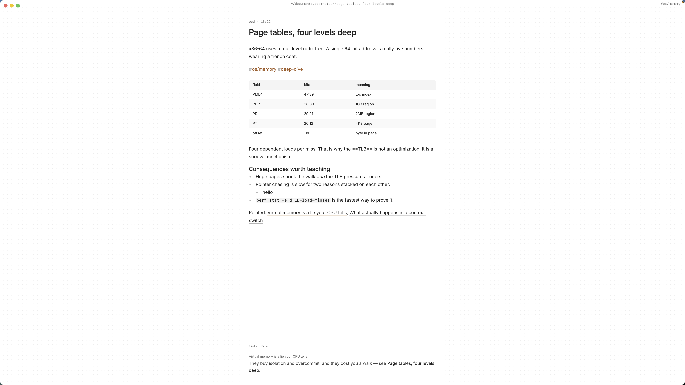

By October half-term, a secondary teacher's planning is usually in four places. The scheme of work is a shared document, this week's slides are in a cloud drive, the lesson you improved on the fly last year exists only as a photo of the whiteboard on your phone, and the marking you owe Year 10 is a sticky note on the laptop. Next September you'll plan the same unit again, and most of what you learned the first time will be gone.

Lesson plans in markdown fix the last part of that. Each lesson is a plain text file on your Mac, linked to the resources and assessments it uses, with the board work pasted in and the tweaks written down. Next year you search for it, copy it and improve it, instead of starting from a blank page.

This article shows a setup for a secondary school teacher in Paperkites: folders per class and unit, a lesson plan template with a timing table, links to resources and assessments, photos of board work, and a to-do list for marking.

## Setting up folders for classes and units

A Paperkites vault is a folder of `.md` files that you choose; there's no account and no database. Make one, say `~/teaching`, open it in Paperkites, and lay it out the way your timetable already is:

- `y9-science/forces/`, `y9-science/cells/`
- `y11-physics/electricity/`, `y11-physics/waves/`
- `resources/` for worksheets, slides and practicals that several lessons share
- `assessment/` for tests, mark schemes and notes on how each class did
- `admin/` for duties, parents' evenings and department meetings

⌘\ shows the sidebar, with folders that mirror the vault on disk.

Tags carry what folders can't. A nested tag per topic, such as `#physics/forces` or `#physics/electricity`, lets a Year 9 lesson and a Year 11 lesson on the same idea find each other. A tag per academic year, like `#year/2026-27`, tells you which version of a plan you're looking at. Keep the list short; you'll use these to narrow searches more than to browse.

## Planning a week of lessons

### A lesson plan you can reuse

Give every lesson its own note, titled so it sorts and searches well: `Y9 Forces L3 Resultant forces`. Inside, keep the same few headings every time: objectives, a timing table, the resources it uses, and a short "how it went" section you fill in afterwards. That last section is the one that pays off next year.

Timings work best as a table. The editor renders tables as you write them, and `:format` tidies the columns when they drift. See [tables, diagrams and math](/docs/tables-diagrams-math) for the syntax, which also covers LaTeX, so an equation like F = ma, or a rearrangement for a worked example, shows properly in the plan.

### Linking lessons to resources and assessments

Rather than copying a worksheet's contents into every lesson, give each shared resource its own note in `resources/` and link to it: `[[Forces worksheet: balanced and unbalanced]]`. Drag the actual file, a PDF or a slide deck, onto that note and it's copied into the vault's `attachments/` folder and shown as a card that opens in its own app. The original stays where it was.

Do the same for assessment. The end-of-unit test gets a note in `assessment/`, and every lesson that builds towards it links there. Open the test note and its backlinks show every lesson that points at it, each with the sentence around the link, which is a quick check that you've actually taught everything the test asks.

`gd` follows the link under the cursor, `K` peeks at it without leaving the lesson, and ⌃o goes back.

### Photos of board work

The best explanation you gave all week was probably on the board. Take a photo, then drag or paste it onto the lesson note. It's copied into `attachments/`, never moved and never written over another file, and it shows in the note. Several photos sit side by side; you can set each to S, M, L or Full and give it a caption, like "Resultant force diagrams, 9X2". The [images and files docs](/docs/images-and-files) have the details.

### Marking as todos

Any line starting with `- [ ]` is a todo. Put marking where it belongs, in the lesson or assessment note it comes from:

- `- [ ] Mark 9X2 forces quiz`
- `- [ ] Feedback on 11P1 required practical write-ups`

⌘↩ ticks one off. `:todos` lists every todo in the vault under Overdue, Today, Upcoming and No date, so the Sunday evening question "what marking do I owe?" has one answer.

### Quick thoughts between lessons

Paperkites opens on a capture box. In the two minutes between lessons, type "9X2 struggled with arrows on free-body diagrams, start L4 with a recap" and press ⌘↩ to keep it as a fragment. Move it into the lesson's "how it went" section at the end of the day. ⏎ is a newline and never saves, and `esc` never throws a draft away.

## An example lesson plan note

```markdown
# Y9 Forces L3 Resultant forces

#physics/forces #year/2026-27

Unit: [[Y9 Forces overview]] · Builds towards [[Y9 Forces end-of-unit test]]

## Objectives
- Calculate the resultant of forces along one line
- Explain balanced and unbalanced forces with a diagram

## Timings
| Time | Activity |
|---|---|
| 0–10 | Starter: three tug-of-war pictures, who wins? |
| 10–25 | Worked examples on the board |
| 25–45 | [[Forces worksheet: balanced and unbalanced]] in pairs |
| 45–55 | Exit ticket, five questions |

## How it went
- 9X2 needed longer on the worked examples; cut the worksheet to Q1–6
- Arrows on diagrams still messy, recap in L4

## To do
- [ ] Mark 9X2 exit tickets
- [x] Print worksheet for 9X4
```

The links connect the lesson to the unit overview, the shared worksheet and the test, so each of those notes shows this lesson among its backlinks.



## Reusing last year's plans

When the unit comes round again, finding last year's work takes seconds:

- **⌘K** finds a note by any word in its title. Type "y9 forces l3" and it's there.
- **`/`** searches the text of every note. `free-body #physics/forces` finds every lesson where free-body diagrams came up, across Year 9 and Year 11, including last year's "how it went" notes.
- **`:tags`** shows the tag tree, and a tag's page shows its child tags and the tags often used with it.

To reuse a plan, start a new note for this year, paste last year's plan in, and change the year tag. Read the "how it went" section first, then fix what it says before you teach it again. Because your plans are plain markdown files, you can also open the vault in any text editor, or keep it in a folder your school backs up.

## Where Pro helps

The core app is free for good, and everything above works without paying. Two Pro features suit teaching:

- **Task markers.** Beyond open and done, five more states picked with ⌘⇧↩: cancelled, moved, scheduled, in progress and priority. "In progress" for the pile of books you've half marked, "moved" for the quiz that got pushed to next week.
- **Locked notes.** `:lock` encrypts a note with a password, so its text, tags, links and attachments never sit readable on disk. It suits notes you shouldn't leave in a plain file, such as pastoral notes or access arrangements for a class. The password can't be recovered.

Pro is one payment with a 14-day trial, no card needed. If the trial ends without buying, Pro features go read-only and every note still opens.

## In short

One note per lesson, the same headings each time, links to the resources and test it serves, and two lines on how it went. The board photos and the marking live in the same place. Next September, the unit you planned this year becomes the starting point rather than a memory.
