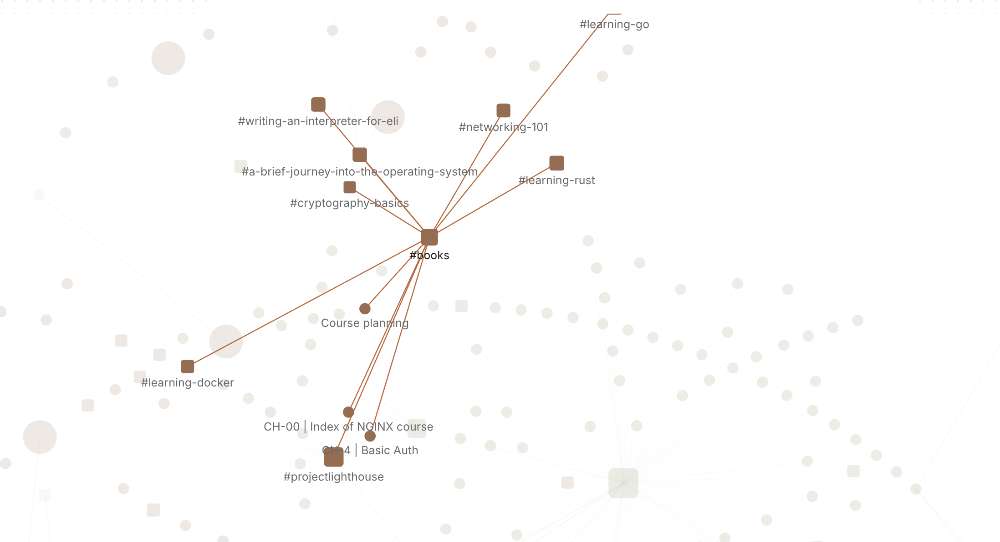

You've read about Luhmann's slip box, and the idea makes sense: write one idea per note, in your own words, and link it to the notes it argues with. The hard part is the tooling. Index numbers to maintain, templates to keep consistent, a folder of notes that slowly fills with orphans you've forgotten about. It's easy for the system to become the hobby, and for the thinking to stop.

What a Zettelkasten actually needs is small: a fast way to catch fleeting thoughts, plain files that will outlast any app, links that carry their context, and a way to spot the notes that have drifted loose. Paperkites keeps every note as a plain `.md` file in a folder you choose, so a Zettelkasten in markdown stays readable in any editor, with no database in between.

This article shows how to set up a slip box in Paperkites, how fleeting notes become permanent ones, and how to keep the whole thing connected as it grows.

## Setting up the slip box

Make a folder such as `~/Zettelkasten` and open it as your vault. If you already keep a slip box in Obsidian, open that folder instead: Paperkites reads it as it is, links by path, file name, title or alias, heading and block links included. See [opening an Obsidian vault](/docs/obsidian).

Keep the structure flat. Two folders are plenty:

- `literature/` for notes on what you read, one per source, in your words with page references.
- Everything else, your permanent notes, at the top level.

⌘\ shows the sidebar, with folders that mirror the vault on disk.

You don't need numbered IDs in the file names. Paperkites manages an `id` and a `created` field in each note's front matter itself and leaves the rest of your front matter alone. Title each permanent note as the claim it makes, such as "Forgetting is part of how memory works", not as a topic like "Memory". If a title gets sharper later, retitle it: every link to the note across the vault is rewritten, and `:undo` reverts it if you change your mind.

Tags play a supporting role in a Zettelkasten, since the links carry the structure. A handful of broad nested ones is enough: `#learning/memory`, `#writing/craft`, `#cities/transport`.

## From fleeting note to permanent note

### Catching fleeting notes as fragments

The app opens on a capture box. When an idea arrives, type it and press ⌘↩: it's kept as a fragment, a short note with no title. Fragments are your fleeting notes. They're cheap to make and you're meant to process them, not keep them forever.

⏎ adds a line and never saves, so you can write a few lines before deciding. `esc` never throws a draft away, even across a quit. And if what you're typing is already a whole idea, ⌘E opens it as a full note on the spot, ready for a title and links.

### Processing the day's fragments

Set aside ten minutes, ideally the same day. The list shows everything newest first with the date once per day, so today's fragments sit together. `j` and `k` move through them; `[d` and `]d` jump a day at a time if you've fallen behind.

For each fragment, ask whether it's worth a permanent note. If it is, write the note in full sentences, as if explaining it to someone who wasn't there, then link it. If it's not, let it go.

### Writing the atomic note

A permanent note holds one idea and links to at least one other. The links that matter most are written into sentences, not listed at the bottom, because a link with a reason is worth more than a link without one.

- `[[Title]]` links to a note, `[[Title|alias]]` changes the link text so the sentence still reads well.
- `[[Title#Heading]]` links to a heading inside a note, useful for pointing at one section of a long literature note.
- `gd` follows the link under the cursor, and `K` peeks at it without leaving the note you're writing. ⌃o and ⌃i go back and forward through where you've been.

When you're writing a permanent note from a literature note, open them side by side: ⌃w v splits the view, ⌃w w moves between panes and ⌃w q closes one. Paraphrase from the left, write on the right. If your literature notes come from books, [book notes in markdown](/usecase/book-notes-markdown-mac) goes deeper on that side of the habit.

### Structure notes

As clusters form, write a structure note: a short note that lists a dozen permanent notes in a sensible order, with one line on why each one belongs. It's the entry point to a line of thought, and it's just another note with links.

## An example permanent note

```markdown
# Forgetting is part of how memory works

#learning/memory

Forgetting isn't the failure of a memory system; it's the
filter. Recall that takes effort strengthens a memory more
than easy recall does, which is why spacing reviews out works
better than cramming. See [[Spacing beats massing]].

This cuts against the urge to capture everything. A slip box
works partly because writing a note in your own words is
effortful recall in disguise, as argued in
[[Writing is thinking#Paraphrase as test]].

Source: [[Lecture notes - how memory works]].

- [ ] Find a counter-example from motor learning
```

One idea, two links in sentences that say why, one heading link into a longer note, the source, and an open question as a todo that `:todos` will keep in front of you.

## Keeping the links alive

### Backlinks with their sentence

At the foot of every note, backlinks show each note that links to it, along with the sentence the link sits in. Open "Spacing beats massing" and you see not only that "Forgetting is part of how memory works" points to it, but why. A link is only as useful as the reason written next to it, and seeing those reasons together is what makes following a chain of notes feel like reading an argument.

### Upkeep with :orphans and #empty_kite

A slip box decays at the edges. Two commands, run once a week, keep it in shape:

- **`:orphans`** lists notes nothing links to. Each one is a question: what does this connect to? Usually the answer is a sentence in an existing note, and writing it improves both.
- **`#empty_kite`** finds notes with no tags. In a Zettelkasten that's often fine, but it's a quick check for permanent notes written in a hurry.

### Search and the tag tree

- **⌘K** finds a note, fragment, tag or command by any word in its title, in under 50 ms on 10,000 items. With claim-style titles, you usually remember enough of the claim to find it.
- **`/`** searches the full text of every note; add `#learning/memory` to narrow it.
- **`:tags`** shows the tag tree, and a tag's page lists its child tags and the tags most often used with it.

[Writing in Paperkites](/docs/writing) and [finding notes](/docs/finding) cover the link syntax and every search option.

## Where Pro helps: the graph

The core app, with wiki links, backlinks, search, `:orphans` and `#empty_kite`, is free for good. The Pro feature that fits a Zettelkasten is **the graph**: `:graph` or `gr` opens a live canvas where tags are nodes and notes hang off the tags they carry.

It's worth being clear on what it shows. It's a map of your topics, not of every note-to-note link. That turns out to be useful in its own way: you see which topics are dense, which are thin, and which notes sit between two tags and might be the bridge for a new structure note. The [graph docs](/docs/graph) explain how to move around it.



Pro is one payment with a 14-day trial, no card needed. If the trial ends without buying, Pro features go read-only and every note still opens.

## In short

Catch thoughts as fragments, process them while they're fresh, and write each permanent note as one claim in your own words, linked in sentences that say why. Check `:orphans` now and then. The slip box will start answering questions you didn't know you'd asked, and it'll do it from plain files you can read anywhere.
